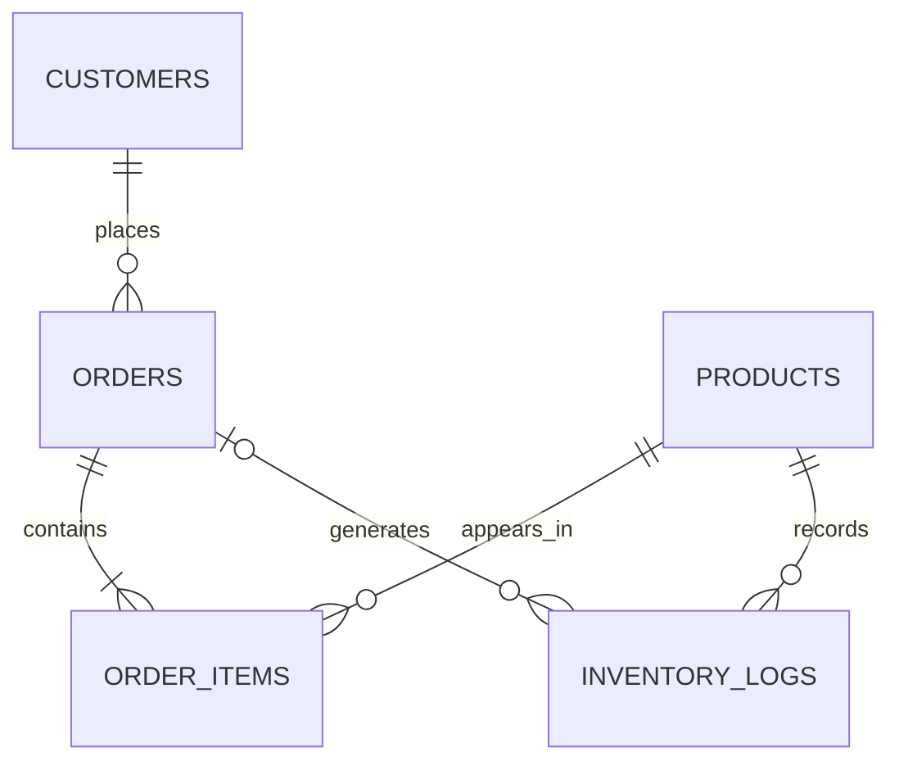

# Inventory & Order Management System — Lab Report

**Lab:** AmaliTech DEM03 — Inventory and Order Management  
**Database:** MySQL 8.0.46  
**Repository:** `Inventory-Order-Mgt`

## Contents

1. [Project overview](#1-project-overview)
2. [Database design and schema](#2-database-design-and-schema)
3. [Order placement and inventory automation](#3-order-placement-and-inventory-automation)
4. [Monitoring and reporting](#4-monitoring-and-reporting)
5. [Stock replenishment and automation](#5-stock-replenishment-and-automation)
6. [Views and performance](#6-views-and-performance)
7. [Testing and verification](#7-testing-and-verification)
8. [Reflection](#8-reflection)
9. [Conclusion](#9-conclusion)

## 1. Project overview

The project is a MySQL 8 transactional database for a small inventory and order-management business. It models customers, products, orders, order lines and inventory history, then automates order placement, stock deduction, discounting, order totals, customer tiers and replenishment.

The implementation is deliberately small and auditable: five core tables, two functions, three views, two triggers, two stored procedures, ten reports, sixteen data-quality checks and a transaction-safe test suite. Every rule that can be enforced by the database is enforced there rather than only in an application layer.

### 1.1 What the project demonstrates

- Relational schema design with primary, unique, foreign-key and `CHECK` constraints
- `DECIMAL` money values and historical price snapshots
- Trigger-driven stock updates, inventory logging and order totals
- A JSON-based `place_order` procedure for multi-product orders
- Bulk discounts and customer tiers
- Low-stock replenishment with a locking loop
- Views, aggregate reports and window functions
- Index design and `EXPLAIN ANALYZE` benchmarking
- Transaction-safe tests and data-quality reconciliation

### 1.2 Deliverables

| Deliverable | File(s) | What it proves |
|---|---|---|
| Schema | `sql/01_schema/01_schema.sql` | Relational design, keys, constraints and data types |
| Indexes | `sql/02_indexes/02_indexes.sql` plus inline indexes | Access-path design |
| Functions | `sql/03_functions/03_functions.sql` | Reusable business rules |
| Views | `sql/04_views/04_views.sql` | Stable reporting interfaces |
| Triggers | `sql/05_triggers/05_triggers.sql` | Automation, locking and integrity |
| Procedures | `sql/06_procedures/06_procedures.sql` | JSON workflow, validation and transactions |
| Seed data | `sql/07_seed/07_seed_data.sql` | Reproducible fixtures |
| Reports | `sql/08_reports/08_reports.sql` | Ten analytical result sets |
| Quality checks | `sql/09_quality/09_data_quality_checks.sql` | Sixteen PASS/FAIL integrity checks |
| Benchmark | `sql/10_benchmark/10_performance_benchmark.sql` | `EXPLAIN ANALYZE` before/after comparison |
| Assembled build | `sql/build/build.sql` | One-step build of stages 00–07 |
| Tests | `tests/sql/*.sql`, `tests/all_tests.sql`, `tests/run_all.sql` | Transaction-safe regression suite |
| Report | `docs/LAB_REPORT.md` | This document |

### 1.3 Execution order

The `sql/` directory is organised so that directory order is execution order:

```text
00_reset -> 01_schema -> 02_indexes -> 03_functions -> 04_views
        -> 05_triggers -> 06_procedures -> 07_seed
        -> 08_reports -> 09_quality -> 10_benchmark
```

Stages 00–07 are also assembled into `sql/build/build.sql` for a one-step build. Reports, quality checks and the benchmark are run separately against the seeded database because they are read-only deliverables.

**Requirements:** MySQL 8.0.16 or newer (verified on 8.0.46), and either MySQL Workbench or the `mysql` command-line client.

## 2. Database design and schema

### 2.1 Goal

Turn the lab brief into a small relational model that protects data quality before any application code runs. The design must support customers, products, orders, order lines and a complete inventory history, while keeping the schema easy to explain and query in MySQL Workbench.

Files: [`sql/01_schema/01_schema.sql`](../sql/01_schema/01_schema.sql), [`sql/02_indexes/02_indexes.sql`](../sql/02_indexes/02_indexes.sql), [`sql/00_reset/00_reset.sql`](../sql/00_reset/00_reset.sql).

### 2.2 Entities and relationships



- A customer places zero or more orders.
- An order contains one or more order lines.
- A product can appear on zero or more order lines.
- A product has zero or more inventory logs.
- An inventory log may belong to one order; opening balances and restocks have no order.

The many-to-many relationship between orders and products is resolved by `order_items`. Quantity, sale price, discount and line total belong to that relationship, not to the order or product alone.

### 2.3 Tables

#### `customers`

| Column | Type | Constraint / purpose |
|---|---|---|
| `customer_id` | `INT` | Primary key, auto-increment |
| `full_name` | `VARCHAR(100)` | Required, non-blank |
| `email` | `VARCHAR(255)` | Required, unique, basic format check |
| `phone` | `VARCHAR(20)` | Optional |
| `created_at` | `DATETIME` | Defaults to the current timestamp |

MySQL's default collation (`utf8mb4_0900_ai_ci`) is case-insensitive, so the unique email index also rejects `AMA@EXAMPLE.COM` when `ama@example.com` exists. That is useful for customer identity. A separate `LOWER(email)` index is unnecessary here, unlike PostgreSQL.

#### `products`

| Column | Type | Constraint / purpose |
|---|---|---|
| `product_id` | `INT` | Primary key, auto-increment |
| `product_name` | `VARCHAR(100)` | Required, unique, non-blank |
| `category` | `VARCHAR(50)` | Required, non-blank |
| `price` | `DECIMAL(10,2)` | Required, non-negative |
| `stock_quantity` | `INT` | Required, default 0, non-negative |
| `reorder_level` | `INT` | Required, default 10, non-negative |
| `created_at` | `DATETIME` | Defaults to the current timestamp |

Money uses `DECIMAL`, not `FLOAT`. `stock_quantity >= 0` is a database-level defence against overselling.

#### `orders`

| Column | Type | Constraint / purpose |
|---|---|---|
| `order_id` | `INT` | Primary key, auto-increment |
| `customer_id` | `INT` | Required FK to `customers` |
| `order_date` | `DATE` | Required, defaults to `CURRENT_DATE` |
| `total_amount` | `DECIMAL(12,2)` | Required, default 0, non-negative |
| `created_at` | `DATETIME` | Actual insert time |

`total_amount` is a deliberate denormalisation. It can be derived from `order_items`, but storing it makes order lists fast. The trigger in Section 3 keeps it correct.

#### `order_items`

| Column | Type | Constraint / purpose |
|---|---|---|
| `order_item_id` | `INT` | Primary key, auto-increment |
| `order_id` | `INT` | Required FK to `orders` |
| `product_id` | `INT` | Required FK to `products` |
| `quantity` | `INT` | Required, greater than zero |
| `unit_price` | `DECIMAL(10,2)` | Required, non-negative; set by trigger |
| `discount_rate` | `DECIMAL(4,2)` | Required, between 0 and 1; set by trigger |
| `line_total` | `DECIMAL(12,2)` | Required, non-negative; set by trigger |

`UNIQUE (order_id, product_id)` prevents the same product appearing on two lines of one order. To buy more, increase the quantity.

`unit_price` is **not** a copy of the current catalogue price. It is the price on the day of sale. If the catalogue price changes next month, old orders must not change.

#### `inventory_logs`

| Column | Type | Constraint / purpose |
|---|---|---|
| `log_id` | `INT` | Primary key, auto-increment |
| `product_id` | `INT` | Required FK to `products` |
| `order_id` | `INT` | Optional FK to `orders` |
| `change_quantity` | `INT` | Required, non-zero, signed |
| `reason` | `VARCHAR(20)` | `opening`, `order`, `restock` or `adjustment` |
| `changed_at` | `DATETIME` | Defaults to the current timestamp |

The signed change is the audit trail:

- opening balance: positive
- sale: negative
- restock: positive
- adjustment: either sign

This lets `SUM(change_quantity)` reconcile exactly to `products.stock_quantity`.

### 2.4 Normalisation and deliberate trade-offs

The model is in third normal form for the operational facts:

- Customer details live once in `customers`.
- Product details live once in `products`.
- An order stores only its customer, date and total.
- An order line stores the quantity and the price/discount actually used.

Two deliberate exceptions:

1. `orders.total_amount` is derivable but stored for fast order lists. The trigger is the synchronisation mechanism.
2. `order_items.unit_price` looks like duplication but is a different fact: the historical sale price.

### 2.5 Referential policy

All foreign keys use `ON DELETE RESTRICT`:

- Deleting a customer with orders is blocked.
- Deleting an order with lines or logs is blocked.
- Deleting a product with sales or stock history is blocked.

This is an audit-first choice. A cascading delete would remove order lines but leave stock deducted and logs behind, which would make reconciliation fail. Cancellation, if needed later, should be an explicit procedure that restores stock and writes adjustment logs.

### 2.6 Seed data

The seed uses explicit IDs for deterministic reports:

| Customer | Email |
|---|---|
| Ama Mensah | `ama@example.com` |
| Kofi Boateng | `kofi@example.com` |
| Esi Owusu | `esi@example.com` |
| Yaw Darko | `yaw@example.com` |

| ID | Product | Price | Opening stock | Reorder |
|---|---|---:|---:|---:|
| 1 | USB-C Cable | 8.50 | 120 | 30 |
| 2 | Wireless Mouse | 25.00 | 15 | 20 |
| 3 | Mechanical Keyboard | 89.99 | 40 | 10 |
| 4 | 27in Monitor | 249.00 | 5 | 8 |
| 5 | Laptop Stand | 39.00 | 0 | 5 |

Opening logs are inserted for products 1–4. Product 5 starts at zero, and a zero-change log would violate the `change_quantity <> 0` check, so it has no opening row. Its first stock movement is the restock in Section 5.

The lesson loads orders directly and leaves stock at the opening values. This project loads orders through `place_order`, so the triggers deduct stock and write logs. That is why the post-seed stock is 105 / 12 / 39 / 2 / 0 and Esi's order total is 126.50 instead of 135.00. The difference is intentional and demonstrates the automation.

### 2.7 Correctness checks

Verified on MySQL 8.0.46:

```sql
SELECT VERSION();
-- 8.0.46

SELECT order_id, customer_id, order_date, total_amount
FROM orders ORDER BY order_id;
-- 50.50, 338.99, 498.00, 126.50, 17.00
```

- Invalid negative price produced `ERROR 3819 (HY000): Check constraint 'chk_products_price' is violated`.
- An order with no date received `CURRENT_DATE` (`2026-10-21`) from the column default.
- A transaction that inserted a customer and order rolled back cleanly, leaving zero customers.
- The schema build and the full [`sql/build/build.sql`](../sql/build/build.sql) both completed without warnings that affected correctness.

`CHECK` violations in MySQL use error 3819 and SQLSTATE `HY000`, not SQLSTATE `23000`. The tests account for this difference.

### 2.8 Limitations

- MySQL has no partial indexes, so low-stock filtering is a table scan. The products table is small; Section 6 discusses the scaling option.
- The email format check is deliberately basic (`%_@_%._%`), not a full RFC validator.
- Orders are append-only. Cancellation and returns are future work.
- The schema has no supplier or purchase-order table; restocking is a direct stock top-up.

## 3. Order placement and inventory automation

### 3.1 Goal

Place a multi-product order in one call, snapshot the sale price, apply the bulk discount, deduct stock, write an inventory log for every line, and update the order total — without the caller having to remember any of those steps.

Files: [`sql/03_functions/03_functions.sql`](../sql/03_functions/03_functions.sql), [`sql/05_triggers/05_triggers.sql`](../sql/05_triggers/05_triggers.sql), [`sql/06_procedures/06_procedures.sql`](../sql/06_procedures/06_procedures.sql), [`sql/07_seed/07_seed_data.sql`](../sql/07_seed/07_seed_data.sql).

### 3.2 Order flow

```text
CALL place_order(customer, JSON items, date, OUT order_id)
        |
        +-- validate customer, JSON shape, items, duplicates, products, stock
        |
        +-- INSERT orders
        |
        +-- INSERT order_items ... SELECT FROM JSON_TABLE ... ORDER BY product_id
                |
                +-- BEFORE trigger: lock product, snapshot price,
                |                   apply discount, calculate line total
                |
                +-- AFTER trigger: lock product, check stock,
                                    deduct stock, insert inventory log,
                                    add line_total to orders.total_amount
```

### 3.3 JSON contract

MySQL has no array parameter type. The procedure accepts a JSON array:

```sql
SET @items = JSON_ARRAY(
  JSON_OBJECT('product_id', 1, 'quantity', 5),
  JSON_OBJECT('product_id', 4, 'quantity', 1)
);

START TRANSACTION;
CALL place_order(3, @items, '2026-09-15', @order_id);
COMMIT;

SELECT @order_id;
```

Each item must have:

- `product_id`: an existing product
- `quantity`: an integer greater than zero

The same product must not appear twice. Increase the quantity instead.

### 3.4 `place_order`

Validation happens before the order row is inserted:

1. Customer id is present.
2. `p_items` is a valid, non-empty JSON **array**.
3. Every item has a product id and a positive quantity.
4. There are no duplicate product ids.
5. The customer exists.
6. Every product exists.
7. Stock is sufficient at validation time.

The stock check is a friendly pre-check. The `AFTER INSERT` trigger repeats the check under a row lock, which is the authoritative concurrency guard.

The procedure does **not** start or commit a transaction. The caller must do it:

```sql
START TRANSACTION;
CALL place_order(...);
COMMIT;
```

If the call fails:

```sql
ROLLBACK;
```

This is deliberate. MySQL stored procedures do not automatically undo earlier statements when a later statement fails. Keeping transaction control with the caller makes the procedure composable and lets the tests roll back their work. A direct `CALL` with autocommit enabled is not the supported pattern for failure handling.

### 3.5 Triggers

#### `trg_order_items_before_insert`

- Rejects a null or non-positive quantity with a clear `SIGNAL`.
- Locks the product row and reads the current catalogue price.
- Rejects an unknown product.
- Overwrites any caller-supplied `unit_price`, `discount_rate` and `line_total`.
- Calculates:

```text
discount = 0.10 when quantity >= 10
           0.05 when quantity >= 5
           0.00 otherwise

line_total = ROUND(quantity * unit_price * (1 - discount), 2)
```

The product row is locked before the price is read, so a concurrent price change cannot slip between the price read and the line insert.

#### `trg_order_items_after_insert`

- Locks the product row and reads `stock_quantity`.
- Rejects the line if stock is insufficient.
- Deducts the quantity.
- Inserts `inventory_logs(product_id, order_id, -quantity, 'order')`.
- Adds `line_total` to `orders.total_amount`.

The trigger cannot update `order_items` (the table that fired it), but it can update `products`, `orders` and `inventory_logs`.

### 3.6 Worked example: Esi's order

```sql
SET @items = JSON_ARRAY(
  JSON_OBJECT('product_id', 1, 'quantity', 10),
  JSON_OBJECT('product_id', 2, 'quantity', 2)
);

START TRANSACTION;
CALL place_order(3, @items, '2026-09-15', @order_id);
COMMIT;
```

Result:

| Line | Quantity | Unit price | Discount | Line total |
|---|---:|---:|---:|---:|
| USB-C Cable | 10 | 8.50 | 0.10 | 76.50 |
| Wireless Mouse | 2 | 25.00 | 0.00 | 50.00 |
| **Order total** | | | | **126.50** |

Stock moves for this order: cable 117 → 107, mouse 14 → 12. A later seed order (Kofi's two cables) brings the cable down to 105. Two sale logs are written with `-10` and `-2`.

The lesson's direct-insert version shows 135.00 for this order because it does not apply the 10% discount to ten cables. The trigger version applies the lab's discount rule.

### 3.7 Inventory audit

Every sale produces one log row. Opening balances and restocks produce positive rows. The reconciliation query is:

```sql
SELECT p.product_id, p.product_name, p.stock_quantity,
       COALESCE(SUM(il.change_quantity), 0) AS logged_total,
       p.stock_quantity - COALESCE(SUM(il.change_quantity), 0) AS variance
FROM products p
LEFT JOIN inventory_logs il ON il.product_id = p.product_id
GROUP BY p.product_id, p.product_name, p.stock_quantity
ORDER BY p.product_id;
```

Seed result:

| Product | Stock | Logged total | Variance |
|---|---:|---:|---:|
| USB-C Cable | 105 | 105 | 0 |
| Wireless Mouse | 12 | 12 | 0 |
| Mechanical Keyboard | 39 | 39 | 0 |
| 27in Monitor | 2 | 2 | 0 |
| Laptop Stand | 0 | 0 | 0 |

After `restock_low_products()`, the three low-stock products have additional positive logs and still reconcile.

### 3.8 Failure paths checked

| Case | Expected result | Verified |
|---|---|---|
| Oversell | `45000`, no order row | yes |
| Unknown customer | `45000` | yes |
| Unknown product | `45000` | yes |
| Empty JSON array | `45000` | yes |
| JSON object instead of array | `45000` | yes |
| Duplicate product id | `45000` | yes |
| Zero quantity | `45000` | yes |
| Caller-supplied price | ignored and replaced by trigger | yes |
| Historical price after catalogue update | old order unchanged | yes |

The tests are in [`tests/sql/03_order_tests.sql`](../tests/sql/03_order_tests.sql) and pass in the full suite.

### 3.9 Correctness notes

- The order line's `unit_price` is a historical snapshot. After changing a product's price, the existing order still shows the old price.
- The order total is recomputed by the trigger from `line_total`, so it includes discounts.
- `ORDER BY jt.product_id` in the insert keeps product-row lock acquisition consistent when concurrent orders contain the same products.
- The application never updates or deletes order lines. Orders are append-only; cancellation is future work.

### 3.10 Limitations

- The procedure requires a caller-managed transaction. This is documented, tested and used by the seed script.
- The concurrency guard is row locking, not an application queue. A high-throughput shop would need retry handling for deadlocks.
- There is no order cancellation or return path.
- The JSON validation accepts the documented object shape; it is not a full JSON Schema validator.

## 4. Monitoring and reporting

### 4.1 Goal

Answer the lab's business questions with views and SQL reports:

- order summaries per customer
- low-stock products
- customer spending and tiers
- bulk-discount impact
- product sales
- inventory movement
- daily/monthly sales and advanced window-function views

Files: [`sql/04_views/04_views.sql`](../sql/04_views/04_views.sql), [`sql/08_reports/08_reports.sql`](../sql/08_reports/08_reports.sql).

### 4.2 Views

#### `v_order_summary`

One row per order with the customer, date, total and total units.

```sql
SELECT order_id, customer_id, customer_name, order_date, total_amount, item_count
FROM v_order_summary
ORDER BY customer_id, order_date;
```

Seed result:

| order_id | customer | date | total | items |
|---:|---|---|---:|---:|
| 1 | Ama Mensah | 2026-09-01 | 50.50 | 4 |
| 3 | Ama Mensah | 2026-09-10 | 498.00 | 2 |
| 2 | Kofi Boateng | 2026-09-03 | 338.99 | 2 |
| 5 | Kofi Boateng | 2026-09-28 | 17.00 | 2 |
| 4 | Esi Owusu | 2026-09-15 | 126.50 | 12 |

`item_count` is the sum of quantities, not the number of lines. Order 4 has two lines but twelve units.

#### `v_low_stock`

Products with `stock_quantity < reorder_level`:

| Product | Stock | Reorder | Shortfall |
|---|---:|---:|---:|
| Wireless Mouse | 12 | 20 | 8 |
| 27in Monitor | 2 | 8 | 6 |
| Laptop Stand | 0 | 5 | 5 |

#### `v_customer_spend`

Customer lifetime spend and tier, including customers with no orders:

| Customer | Spend | Tier |
|---|---:|---|
| Ama Mensah | 548.50 | Gold |
| Kofi Boateng | 355.99 | Silver |
| Esi Owusu | 126.50 | Bronze |
| Yaw Darko | 0.00 | Bronze |

### 4.3 Reports

[`sql/08_reports/08_reports.sql`](../sql/08_reports/08_reports.sql) contains ten reports. The important results are summarised here; the file has the full SQL.

#### 1. Customer order summary

| Customer | Orders | Total spend | Avg order | Units |
|---|---:|---:|---:|---:|
| Ama Mensah | 2 | 548.50 | 274.25 | 6 |
| Kofi Boateng | 2 | 355.99 | 178.00 | 4 |
| Esi Owusu | 1 | 126.50 | 126.50 | 12 |
| Yaw Darko | 0 | 0.00 | 0.00 | 0 |

The report uses a pre-aggregated `order_items` subquery so joining lines does not multiply `orders.total_amount`.

#### 2. Customer order detail

Report 2 lists every order with its date, total and unit count. It is the row-level companion to report 1.

#### 3. Low-stock and suggested restock

| Product | Stock | Reorder | Shortfall | Suggested top-up |
|---|---:|---:|---:|---:|
| Wireless Mouse | 12 | 20 | 8 | 28 |
| 27in Monitor | 2 | 8 | 6 | 14 |
| Laptop Stand | 0 | 5 | 5 | 10 |

`Suggested top-up = 2 × reorder_level − stock`, matching the Section 5 procedure.

#### 4. Customer tiers

| Tier | Customers | Total spend | Average spend |
|---|---:|---:|---:|
| Gold | 1 | 548.50 | 548.50 |
| Silver | 1 | 355.99 | 355.99 |
| Bronze | 2 | 126.50 | 63.25 |

Tier rules live in `customer_tier()`:

- Gold: `>= 500`
- Silver: `>= 200`
- Bronze: below 200

#### 5. Product sales

| Product | Units | Orders | Gross | Discount | Net |
|---|---:|---:|---:|---:|---:|
| 27in Monitor | 3 | 2 | 747.00 | 0.00 | 747.00 |
| USB-C Cable | 15 | 3 | 127.50 | 8.50 | 119.00 |
| Mechanical Keyboard | 1 | 1 | 89.99 | 0.00 | 89.99 |
| Wireless Mouse | 3 | 2 | 75.00 | 0.00 | 75.00 |

`gross = quantity × unit_price`; `discount = gross − line_total`; `net = line_total`. The 8.50 discount comes from Esi's ten cables at 10%.

#### 6. Inventory movement

| Product | Stock | Opening | Sold | Restocked | Logged | Variance |
|---|---:|---:|---:|---:|---:|---:|
| USB-C Cable | 105 | 120 | -15 | 0 | 105 | 0 |
| Wireless Mouse | 12 | 15 | -3 | 0 | 12 | 0 |
| Mechanical Keyboard | 39 | 40 | -1 | 0 | 39 | 0 |
| 27in Monitor | 2 | 5 | -3 | 0 | 2 | 0 |
| Laptop Stand | 0 | 0 | 0 | 0 | 0 | 0 |

This is the audit report: `variance` must be zero.

#### 7. Daily sales

| Date | Orders | Units | Net revenue |
|---|---:|---:|---:|
| 2026-09-01 | 1 | 4 | 50.50 |
| 2026-09-03 | 1 | 2 | 338.99 |
| 2026-09-10 | 1 | 2 | 498.00 |
| 2026-09-15 | 1 | 12 | 126.50 |
| 2026-09-28 | 1 | 2 | 17.00 |

#### 8. Monthly sales and month-over-month growth

The seed data covers one month:

| Month | Orders | Units | Net revenue | Previous | MoM % |
|---|---:|---:|---:|---:|---:|
| 2026-09 | 5 | 22 | 1030.99 | NULL | NULL |

`LAG()` returns NULL for the first month, which is correct. Add another month of orders to see a growth percentage.

#### 9. Product rank within category

| Category | Product | Net revenue | Rank |
|---|---|---:|---:|
| Accessories | USB-C Cable | 119.00 | 1 |
| Accessories | Wireless Mouse | 75.00 | 2 |
| Displays | 27in Monitor | 747.00 | 1 |
| Peripherals | Mechanical Keyboard | 89.99 | 1 |

`DENSE_RANK() OVER (PARTITION BY category ORDER BY net_revenue DESC)` keeps ties at the same rank without gaps.

#### 10. Customer share of total spend

| Customer | Spend | Tier | Rank | Share |
|---|---:|---|---:|---:|
| Ama Mensah | 548.50 | Gold | 1 | 53.20% |
| Kofi Boateng | 355.99 | Silver | 2 | 34.53% |
| Esi Owusu | 126.50 | Bronze | 3 | 12.27% |
| Yaw Darko | 0.00 | Bronze | 4 | 0.00% |

`SUM(total_spend) OVER ()` gives the denominator without a second query.

### 4.4 Correctness checks

- All ten reports execute under `ONLY_FULL_GROUP_BY` without errors.
- Customer spend sums to **1030.99**, matching the sum of order totals.
- Product net revenue sums to **1030.99**.
- Inventory movement variance is zero for every product.
- Tiers match `customer_tier(total_spend)`.
- Low-stock rows match `stock_quantity < reorder_level`.
- Window functions return the expected ranks and shares.

The view tests in [`tests/sql/05_views_test.sql`](../tests/sql/05_views_test.sql) assert the seed values.

### 4.5 Limitations

- The seed has one month, so the month-over-month growth report has one row and no comparison yet.
- The reports are read-only and use the live tables. There is no materialised view or nightly summary table; MySQL does not have materialised views.
- Product sales use the historical `unit_price`, so a catalogue price change does not rewrite past revenue.

## 5. Stock replenishment and automation

### 5.1 Goal

Find every product below its reorder point, top it up to a useful level, and record the stock change in `inventory_logs` — without manual updates.

File: [`sql/06_procedures/06_procedures.sql`](../sql/06_procedures/06_procedures.sql), procedure `restock_low_products()`.

### 5.2 Rule

A product is low when:

```sql
stock_quantity < reorder_level
```

The replenishment target is:

```text
new stock = 2 × reorder_level
add quantity = (2 × reorder_level) − current stock
```

Products at exactly the reorder level are not touched.

### 5.3 Why a loop, not a data-modifying CTE

The lesson's PostgreSQL version uses a data-modifying CTE:

```sql
WITH low AS (... FOR UPDATE),
     topped_up AS (UPDATE ... RETURNING ...)
INSERT INTO inventory_logs ...
```

MySQL has no `UPDATE ... RETURNING` and no data-modifying CTEs. A cursor over `products` while updating `products` is also awkward because MySQL cursors are asensitive. This project uses a small `WHILE` loop with a fresh locking read:

```sql
WHILE v_done = 0 DO
  SET v_product_id = NULL;

  SELECT product_id, stock_quantity, reorder_level
    INTO v_product_id, v_stock, v_reorder
    FROM products
   WHERE stock_quantity < reorder_level
   ORDER BY product_id
   LIMIT 1
   FOR UPDATE;

  IF v_product_id IS NULL THEN
    SET v_done = 1;
  ELSE
    SET v_add_qty = (v_reorder * 2) - v_stock;

    UPDATE products
       SET stock_quantity = stock_quantity + v_add_qty
     WHERE product_id = v_product_id;

    INSERT INTO inventory_logs
      (product_id, change_quantity, reason)
    VALUES
      (v_product_id, v_add_qty, 'restock');
  END IF;
END WHILE;
```

Properties:

- `FOR UPDATE` locks the selected product before its stock is read.
- The loop always picks the lowest product id, so it does not revisit the product it just topped up.
- The update makes the product non-low (`2 × reorder > reorder`), so the next iteration moves on.
- The log is written in the same transaction as the stock update.
- A `NOT FOUND` handler ends the loop when there are no low products.

### 5.4 Transaction pattern

The procedure does not commit:

```sql
START TRANSACTION;
CALL restock_low_products();
COMMIT;
```

If anything fails, `ROLLBACK` restores both the stock and the logs. The tests call the procedure inside a transaction and roll back afterwards.

### 5.5 Worked example

After the seed orders, three products are low:

| Product | Stock before | Reorder | Add | Stock after | Log |
|---|---:|---:|---:|---:|---:|
| Wireless Mouse | 12 | 20 | +28 | 40 | `restock +28` |
| 27in Monitor | 2 | 8 | +14 | 16 | `restock +14` |
| Laptop Stand | 0 | 5 | +10 | 10 | `restock +10` |

The keyboard (39 ≥ 10) and cable (105 ≥ 30) are untouched.

After the call, `v_low_stock` returns zero rows. The inventory audit still reconciles:

| Product | Stock | Logged total | Variance |
|---|---:|---:|---:|
| USB-C Cable | 105 | 105 | 0 |
| Wireless Mouse | 40 | 40 | 0 |
| Mechanical Keyboard | 39 | 39 | 0 |
| 27in Monitor | 16 | 16 | 0 |
| Laptop Stand | 10 | 10 | 0 |

### 5.6 Idempotence

Calling `restock_low_products()` a second time immediately after the first call does nothing:

- no product satisfies `stock < reorder_level`
- no stock changes
- no new restock logs

This is tested explicitly in [`tests/sql/04_inventory_tests.sql`](../tests/sql/04_inventory_tests.sql).

### 5.7 Automation already in place

The order path is automated by the Section 3 triggers:

- stock deduction on every order line
- sale log on every order line
- order total update on every order line
- historical price snapshot and discount calculation

`restock_low_products()` completes the inventory side. Customer tiers are computed live by `customer_tier()` and `v_customer_spend`, so they do not need a scheduled update.

### 5.8 Correctness checks

- Seed low-stock count: 3.
- After a test product with zero stock is added: 4.
- After restock: 0.
- Restock logs: +28, +14, +10 for the seed products.
- A non-low product receives no restock log.
- A second call adds no stock and no log.
- All restock log quantities are positive.
- Stock still reconciles to `SUM(inventory_logs.change_quantity)`.

### 5.9 Limitations

- Replenishment tops up to `2 × reorder_level`; there is no supplier, purchase order, lead time or cost tracking.
- The loop is row-by-row. At warehouse scale, a set-based staging table or a scheduled job would be better.
- `restock_low_products()` acts on every low product in the database. A production system would probably filter by warehouse or supplier.
- The procedure relies on the caller's transaction, as documented in Section 3.

## 6. Views and performance

### 6.1 Goal

Keep the reporting queries readable through views, and make the common access paths efficient as orders grow. MySQL has different indexing rules from PostgreSQL, so the design adapts rather than copies the lesson.

Files: [`sql/02_indexes/02_indexes.sql`](../sql/02_indexes/02_indexes.sql), [`sql/10_benchmark/10_performance_benchmark.sql`](../sql/10_benchmark/10_performance_benchmark.sql), [`sql/04_views/04_views.sql`](../sql/04_views/04_views.sql).

### 6.2 Index inventory

| Index | Columns | Why |
|---|---|---|
| `idx_orders_customer_date` | `orders (customer_id, order_date)` | Customer history, newest-first scans, customer FK |
| `idx_orders_order_date` | `orders (order_date)` | Date-range and daily/monthly reports |
| `uq_order_items_order_product` | `order_items (order_id, product_id)` | One line per product per order; also covers `order_id` |
| `idx_order_items_product` | `order_items (product_id)` | Product-sales joins and product FK |
| `idx_inventory_logs_product_time` | `inventory_logs (product_id, changed_at)` | Per-product audit history and product FK |
| `idx_inventory_logs_order` | `inventory_logs (order_id)` | Audit by order and order FK |
| `uq_customers_email` | `customers (email)` | Unique customer identity |
| `uq_products_name` | `products (product_name)` | Unique product name |

#### MySQL auto-index behaviour

MySQL automatically creates an index on a foreign-key column when no suitable index exists. If the schema created the FK first and added a composite index later, the database would keep a redundant single-column index.

To avoid that, every FK-supporting index is declared **inside** the table definition in `01_schema.sql`:

- `orders (customer_id, order_date)` supports the customer FK
- `order_items (order_id, product_id)` supports the order FK
- `order_items (product_id)` supports the product FK
- `inventory_logs (product_id, changed_at)` supports the product FK
- `inventory_logs (order_id)` supports the order FK

`02_indexes.sql` only adds `orders (order_date)`, which is not needed by a FK.

### 6.3 Deliberately omitted indexes

| Omitted index | Reason |
|---|---|
| `order_items (order_id)` | The unique `(order_id, product_id)` index already serves the leftmost column |
| `orders (customer_id)` | The composite `(customer_id, order_date)` index serves it |
| `inventory_logs (product_id)` | The composite `(product_id, changed_at)` index serves it |
| `LOWER(email)` | MySQL's default case-insensitive collation already enforces case-insensitive uniqueness |
| Low-stock partial index | MySQL does not support partial indexes |

The missing low-stock partial index is a real limitation. The products table is intentionally small, so a full scan is cheap. If the catalogue grew to millions of rows, the options are:

1. Add a stored generated column `is_low_stock` and index it.
2. Maintain a low-stock summary table from triggers or a scheduled job.
3. Put the low-stock check in the application's cache.

Adding an index on `(stock_quantity, reorder_level)` would **not** help: the predicate compares two columns, so it is not a constant range lookup.

### 6.4 Benchmark

[`sql/10_benchmark/10_performance_benchmark.sql`](../sql/10_benchmark/10_performance_benchmark.sql) creates a temporary 200,000-row `big_orders` table, runs the customer-order query, adds `(customer_id, order_date)`, and reruns it.

#### Before index

```text
-> Sort: big_orders.order_date DESC  (cost=20490 rows=200729)
    (actual time=31.4..31.4 rows=40 loops=1)
    -> Filter: (big_orders.customer_id = 42)
       (actual time=0.89..31.4 rows=40 loops=1)
        -> Table scan on big_orders  (cost=20490 rows=200729)
           (actual time=0.884..25.9 rows=200000 loops=1)
```

Actual result: **200,000 rows scanned**, 40 matching rows, **31.4 ms** in the final clean run. An earlier run took 41.7 ms; buffer state affects the absolute time.

#### After index

```text
-> Covering index lookup on big_orders
   using idx_big_orders_customer_date (customer_id=42) (reverse)
   (cost=5.05 rows=40) (actual time=0.039..0.0648 rows=40 loops=1)
```

Actual result: **40 rows**, **0.065 ms** in the final run (0.077 ms earlier), and the index is covering because it contains both selected columns.

This is why the real `orders` table has `(customer_id, order_date)` from the start. It supports "this customer's orders, newest first" without a filesort.

### 6.5 Sargable date filters

Use ranges, not functions on the column:

```sql
-- Good: can use idx_orders_order_date
WHERE order_date >= '2026-09-01'
  AND order_date <  '2026-10-01'

-- Bad: hides the column from the index
WHERE YEAR(order_date) = 2026
```

`DATE_FORMAT` appears in the monthly report's `GROUP BY`, which is acceptable for a small report. The filter should stay a range.

### 6.6 View performance

MySQL merges simple views into the outer query, so `v_order_summary` and `v_low_stock` do not add storage. The order summary uses a join and aggregation; the low-stock view is a filtered table scan. Neither view is materialised.

`EXPLAIN` on the view queries shows the underlying plan. For high-volume reporting, a summary table refreshed by a scheduled job would be the MySQL equivalent of a materialised view.

### 6.7 Correctness checks

- `EXPLAIN ANALYZE` before the index shows a full table scan; after the index it shows a covering index lookup.
- The benchmark query returns 40 rows in both cases.
- All reports and views still return the expected seed values after indexing.
- No duplicate FK indexes were created.
- Data-quality checks remain all `PASS`.

### 6.8 Limitations

- The benchmark uses a temporary table with two columns, not the full schema. It isolates index behaviour rather than simulating a production workload.
- There is no load test with concurrent writers.
- MySQL's optimizer may choose a different plan at other data distributions; `ANALYZE TABLE` keeps statistics fresh.
- The low-stock view is a full scan. See the scaling options above.

## 7. Testing and verification

### 7.1 Strategy

The test suite is transaction-safe:

- Each test file starts with `START TRANSACTION`.
- Each test file ends with `ROLLBACK`.
- The procedures do not commit internally.
- Expected failures are caught by `assert_raises`, so the test can continue and the transaction remains usable.
- The seed database is left unchanged after a test run.

Two assertion helpers live in [`tests/sql/00_test_helpers.sql`](../tests/sql/00_test_helpers.sql):

- `assert_true(condition, label)` raises `SQLSTATE 45000` when the condition is false or null.
- `assert_raises(sql_text, expected_sqlstate, label)` prepares and executes dynamic SQL inside a nested block with a scoped `CONTINUE HANDLER`. It reports a failure if the statement succeeds or returns the wrong SQLSTATE.

The scoped handler matters: if the `SIGNAL` used to report a failed assertion were inside the same handler scope, it would be swallowed.

### 7.2 Test files

| File | What it covers |
|---|---|
| `tests/sql/01_constraints_test.sql` | Duplicate/case-insensitive email, email format, blank names, negative price/stock/reorder, duplicate product name, FK violations, duplicate order line, invalid quantity, unknown product, invalid discount update, zero/invalid inventory log |
| `tests/sql/02_functions_test.sql` | Tier boundaries (0, 199.99, 200, 499.99, 500, 1000) and discount boundaries (0, 4, 5, 9, 10, 100) |
| `tests/sql/03_order_tests.sql` | Multi-product order, discount/total calculations, stock deduction, sale logs, historical price snapshot, caller-price rejection, oversell, unknown customer/product, empty/non-array/duplicate/zero-quantity JSON, default order date |
| `tests/sql/04_inventory_tests.sql` | Seed low-stock count, restock top-up, non-low product unchanged, positive logs, idempotent second call, reconciliation after restock |
| `tests/sql/05_views_test.sql` | Order summary rows, order 4 item count, low-stock membership, customer spend and tiers, total spend |

### 7.3 How to run

#### Workbench

1. Run [`sql/build/build.sql`](../sql/build/build.sql) once.
2. Open [`tests/all_tests.sql`](../tests/all_tests.sql) and execute the whole script.

`tests/all_tests.sql` is the combined suite assembled from the five modular test files plus the helpers, so it needs no `SOURCE` support.

#### CLI

```powershell
$env:MYSQL_PWD = "<your local MySQL password>"
mysql -u root -e "source sql/build/build.sql"
mysql -u root --table -e "source tests/all_tests.sql"
Remove-Item Env:MYSQL_PWD
```

Alternatively, run the modular suite from the repository root:

```powershell
mysql -u root --table -e "source tests/run_all.sql"
```

### 7.4 Clean-build result

The final clean rebuild was:

```text
Database reset complete.
Schema created.
Additional indexes created.
Functions created.
Views created.
Triggers created.
Procedures created.
Seed data loaded.
Test helpers created.
01_constraints_test passed
02_functions_test passed
03_order_tests passed
04_inventory_tests passed
05_views_test passed
```

The exact run used MySQL 8.0.46 on port 3306. Both runners — the combined Workbench suite and the modular CLI runner — completed with all five suites passing.

### 7.5 Data-quality result

[`sql/09_quality/09_data_quality_checks.sql`](../sql/09_quality/09_data_quality_checks.sql) returned `PASS` for all sixteen checks:

| Check | Issues |
|---|---:|
| stock equals sum of inventory logs | 0 |
| order total equals sum of line totals | 0 |
| every order has at least one item | 0 |
| every order item belongs to an order | 0 |
| every inventory log belongs to a product | 0 |
| order lines have valid quantity and price | 0 |
| line totals match quantity, price and discount | 0 |
| discount rates follow the bulk rule | 0 |
| sale logs match order-line quantities | 0 |
| stock and reorder levels are non-negative | 0 |
| inventory log changes and reasons are valid | 0 |
| customer emails are unique | 0 |
| customer emails pass the format check | 0 |
| order lines are unique per order and product | 0 |
| low-stock view matches the product rule | 0 |
| customer tiers match total spend | 0 |

### 7.6 Issues found and fixed during implementation

1. **MySQL `CHECK` errors use SQLSTATE `HY000`.**
   Invalid price/stock tests initially looked like ordinary constraint errors. MySQL raises error 3819 with SQLSTATE `HY000`, while duplicate/FK violations use `23000`. The tests were split accordingly.

2. **`assert_raises` needed a scoped handler.**
   A procedure-level `CONTINUE HANDLER` would catch the `SIGNAL` used to report a failed assertion. The handler is now inside a nested `BEGIN ... END` block.

3. **Cascading deletes would break the audit trail.**
   A cascade policy would remove an order's lines while leaving stock deducted and logs behind. This project uses `ON DELETE RESTRICT`: orders, order lines, products and logs are permanent audit records.

4. **A zero-stock opening log is invalid.**
   `change_quantity <> 0` rejects a zero opening row. Product 5 starts at zero and has no opening log; its first movement is the restock. Reconciliation still works because `COALESCE(SUM(...), 0)` treats missing logs as zero.

5. **Opening a cursor on the table being updated is awkward in MySQL.**
   The restock procedure uses a `WHILE` loop with a fresh `SELECT ... LIMIT 1 FOR UPDATE` instead of a cursor over `products`. This keeps the loop stable and the lock explicit.

6. **MySQL procedures do not roll back earlier statements automatically.**
   The procedures intentionally leave transaction control to the caller. The seed and tests wrap calls in transactions. This is documented in Section 3 and in the README.

7. **The lesson's Esi total differs.**
   The direct-insert lesson total is 135.00 because it does not apply the bulk discount. This project applies 10% to ten cables, so the total is 126.50. The difference is intentional and tested.

### 7.7 Limitations

- The tests use a single connection. They do not simulate two concurrent sessions racing for the last item. The row-locking design is documented, but a concurrency stress test is future work.
- The benchmark is a synthetic two-column table, not a full production workload.
- Tests assume the seed state produced by `sql/build/build.sql`.
- Auto-increment values can have gaps after rolled-back test rows; this is normal and harmless.
- MySQL's `CHECK` enforcement requires 8.0.16+; the project was verified on 8.0.46.

## 8. Reflection

This lab was my first time building a complete database workflow rather than a set of isolated queries. The biggest lesson was that the database can enforce a lot of correctness if the schema is designed carefully. Foreign keys, `CHECK` constraints and unique keys caught mistakes before they became report problems.

### 8.1 What I learned

**Constraints are part of the design, not decoration.** The `CHECK (stock_quantity >= 0)` constraint, the unique order line, and the foreign keys all prevented bad states in testing. Writing the failure tests made me think about what should go wrong, not just what should work.

**Triggers are powerful but need a clear contract.** The order-line trigger is convenient: the caller inserts a product and quantity, and the trigger fills in the sale price, discount, line total, stock deduction, log and order total. But it also means the trigger must be tested directly, not only through the procedure. The `BEFORE` trigger ignores a caller-supplied price, which is important for historical accuracy.

**Transactions belong to the caller.** In MySQL, a stored procedure does not automatically undo earlier statements when a later statement fails. I kept `START TRANSACTION` / `COMMIT` outside `place_order` and `restock_low_products`. That made the seed and tests predictable, and it lets the tests roll back cleanly.

**MySQL is not PostgreSQL with different syntax.** The biggest adaptations were:

- `JSON_TABLE` instead of arrays
- `LAST_INSERT_ID()` instead of `RETURNING`
- `SIGNAL` instead of `RAISE`
- no partial indexes
- automatic FK indexes
- `CHECK` violations surfacing as SQLSTATE `HY000`, not `23000`
- no data-modifying CTEs, so restock uses a `WHILE` loop with a locking read

The case-insensitive default collation was also a useful surprise: the unique email index already rejects case-only duplicates, so a `LOWER(email)` index would not add value here.

### 8.2 What was difficult

The hardest part was not the SQL syntax; it was deciding where each rule belongs. For example:

- Should stock be checked in the procedure, the trigger, or both?
- Should the order total be calculated in the procedure or maintained by the trigger?
- Should a failed order leave an empty order row?
- Should deleting an order cascade to its lines?

I ended up with:

- a friendly stock pre-check in the procedure
- the authoritative stock check in the `AFTER INSERT` trigger under a row lock
- the line total and order total maintained by triggers
- caller-managed transactions so a failed order can be rolled back
- `ON DELETE RESTRICT` so audit history cannot be silently destroyed

The restock loop was another design choice. A cursor over `products` while updating `products` felt fragile in MySQL. The `WHILE` loop with a fresh `LIMIT 1 FOR UPDATE` is easier to reason about and still demonstrates procedural SQL.

### 8.3 What I would do next

If this were a production system, I would add:

- a cancellation/return procedure that restores stock and writes adjustment logs
- a supplier and purchase-order table instead of direct restock top-ups
- a concurrency test with two sessions racing for the last item
- a generated `is_low_stock` column and index, or a low-stock summary table
- a scheduled summary table for heavy reporting
- a Docker/CI setup so the build and tests run on every push

I would also add more months of seed data so the month-over-month report has a real comparison.

## 9. Conclusion

The project is small, but every phase is connected: the schema protects the data, the triggers automate the order flow, the reports explain the business, the restock procedure closes the inventory loop, and the tests prove the pieces fit together.

The final implementation was verified on 25 October 2026 after the SQL stages and tests were reorganised into numbered directories. The clean build completed through seed data, all ten reports returned their expected result sets, all sixteen data-quality checks returned `PASS`, all five test suites passed through both runners, and the benchmark confirmed the intended full-scan-to-covering-index improvement.
