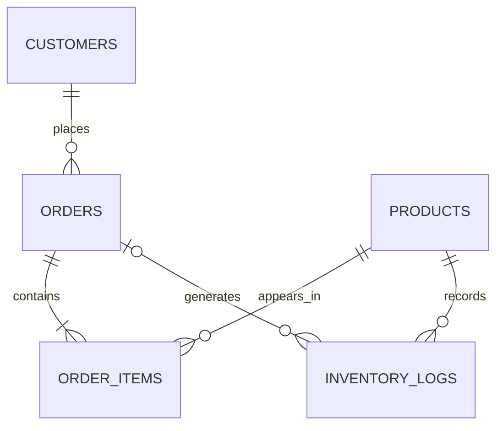

# Inventory & Order Management System — Lab Report

**Lab:** AmaliTech DEM03 — Inventory and Order Management  
**Database:** MySQL 8.0.46  
**Repository:** `Inventory-Order-Mgt`

> **What this report is.** This is my graded submission for the DEM03 lab. I built a MySQL 8 transactional database for a small inventory and order-management business, and this report explains what I built, why I made each design choice, how I tested it, and what I learned. The SQL files and tests are the executable source of truth; this document is my account of the work.

## Contents

1. [Project overview](#1-project-overview)
2. [Database design and schema](#2-database-design-and-schema)
3. [Order placement and inventory automation](#3-order-placement-and-inventory-automation)
4. [Monitoring and reporting](#4-monitoring-and-reporting)
5. [Stock replenishment and automation](#5-stock-replenishment-and-automation)
6. [Views and performance](#6-views-and-performance)
7. [Testing and verification](#7-testing-and-verification)
8. [Reflection](#8-reflection)
9. [Conclusion](#9-conclusion)

## 1. Project overview

I built this project as a MySQL 8 transactional database for a small inventory and order-management business. It models customers, products, orders, order lines and inventory history, then automates order placement, stock deduction, discounting, order totals, customer tiers and replenishment.

I deliberately kept the implementation small and auditable: five core tables, two functions, three views, two triggers, two stored procedures, ten reports, sixteen data-quality checks and a transaction-safe test suite. Where a rule could be enforced by the database, I enforced it there rather than leaving it to an application layer.

### 1.1 What I set out to demonstrate

The main things I wanted the finished database to demonstrate were:

- Relational schema design with primary, unique, foreign-key and `CHECK` constraints
- `DECIMAL` money values and historical price snapshots
- Trigger-driven stock updates, inventory logging and order totals
- A JSON-based `place_order` procedure for multi-product orders
- Bulk discounts and customer tiers
- Low-stock replenishment with a locking loop
- Views, aggregate reports and window functions
- Index design and `EXPLAIN ANALYZE` benchmarking
- Transaction-safe tests and data-quality reconciliation

### 1.2 Deliverables

| Deliverable | File(s) | What it proves |
|---|---|---|
| Schema | `sql/01_schema/01_schema.sql` | Relational design, keys, constraints and data types |
| Indexes | `sql/02_indexes/02_indexes.sql` plus inline indexes | Access-path design |
| Functions | `sql/03_functions/03_functions.sql` | Reusable business rules |
| Views | `sql/04_views/04_views.sql` | Stable reporting interfaces |
| Triggers | `sql/05_triggers/05_triggers.sql` | Automation, locking and integrity |
| Procedures | `sql/06_procedures/06_procedures.sql` | JSON workflow, validation and transactions |
| Seed data | `sql/07_seed/07_seed_data.sql` | Reproducible fixtures |
| Reports | `sql/08_reports/08_reports.sql` | Ten analytical result sets |
| Quality checks | `sql/09_quality/09_data_quality_checks.sql` | Sixteen PASS/FAIL integrity checks |
| Benchmark | `sql/10_benchmark/10_performance_benchmark.sql` | `EXPLAIN ANALYZE` before/after comparison |
| Assembled build | `sql/build/build.sql` | One-step build of stages 00–07 |
| Tests | `tests/sql/*.sql`, `tests/all_tests.sql`, `tests/run_all.sql` | Transaction-safe regression suite |
| Report | `docs/LAB_REPORT.md` | This document |

### 1.3 Build order

I organised the `sql/` directory so that directory order is execution order:

```text
00_reset -> 01_schema -> 02_indexes -> 03_functions -> 04_views
        -> 05_triggers -> 06_procedures -> 07_seed
        -> 08_reports -> 09_quality -> 10_benchmark
```

I assembled stages 00–07 into `sql/build/build.sql` so the project can be built in one step. I run the reports, quality checks and benchmark separately against the seeded database because they are read-only deliverables.

**Requirements:** MySQL 8.0.16 or newer (I verified on 8.0.46), and either MySQL Workbench or the `mysql` command-line client.

### 1.4 Architecture at a glance

I arranged the project into five layers. Each layer has one job, and the layers only depend downward:

```text
+--------------------------------------------------------------+
| Client                                                       |
| MySQL Workbench or the mysql command-line client             |
+------------------------------+-------------------------------+
                               |
+------------------------------v-------------------------------+
| Interface layer                                              |
| JSON order contract, views, reports, quality-check queries   |
+------------------------------+-------------------------------+
                               |
+------------------------------v-------------------------------+
| Programmable layer                                           |
| functions, BEFORE/AFTER triggers, stored procedures          |
+------------------------------+-------------------------------+
                               |
+------------------------------v-------------------------------+
| Storage layer                                                |
| InnoDB tables, keys, constraints, indexes, transaction log   |
+------------------------------+-------------------------------+
                               |
+------------------------------v-------------------------------+
| Verification layer                                           |
| seed fixtures, assertion-based tests, reconciliation checks  |
+--------------------------------------------------------------+
```

| Layer | Objects | Responsibility |
|---|---|---|
| Storage | `customers`, `products`, `orders`, `order_items`, `inventory_logs` | Hold the facts and reject invalid states |
| Programmable | `customer_tier`, `bulk_discount_rate`, two triggers, `place_order`, `restock_low_products` | Encode business rules once, close to the data |
| Interface | Three views and ten reports | Give readers a stable, named shape for common questions |
| Verification | Sixteen quality checks and five test suites | Prove that the rules still hold after changes |
| Operations | Reset, build, benchmark, READMEs | Make the project reproducible and explainable |

The most important architectural choice I made was to keep **correctness independent of the client**. A careless `INSERT` still hits the `CHECK` constraints and triggers. A different client can call the same procedures. A report writer can query a view without knowing the join order. I wanted the database to act as a shared contract rather than a passive file store.

### 1.5 Repository map

| Path | What lives there | Why it matters |
|---|---|---|
| `sql/00_reset/` | Safe teardown of the lab objects | Dependency order and repeatable rebuilds |
| `sql/01_schema/` | Tables, keys, checks, indexes declared inline | Data modelling and constraint design |
| `sql/02_indexes/` | The date index that is not needed by a foreign key | Separating schema from access-path tuning |
| `sql/03_functions/` | Tier and discount rules | Deterministic functions and boundary thinking |
| `sql/04_views/` | Three reporting views | Join shape, aggregation and reuse |
| `sql/05_triggers/` | Price snapshot, stock, log and total automation | Trigger semantics and row locking |
| `sql/06_procedures/` | JSON order placement and replenishment | Validation, procedural SQL and transactions |
| `sql/07_seed/` | Deterministic fixtures | Reproducible demonstrations and tests |
| `sql/08_reports/` | Ten business reports | Aggregates, CTEs and window functions |
| `sql/09_quality/` | Sixteen set-based integrity checks | Reconciliation and invariant testing |
| `sql/10_benchmark/` | Synthetic index benchmark | `EXPLAIN ANALYZE` and covering indexes |
| `sql/build/build.sql` | Assembled stages 00–07 | One-step build; kept in sync with the stages |
| `tests/sql/` | Modular test sources and helpers | Assertion design and failure paths |
| `tests/all_tests.sql` | Assembled Workbench-friendly suite | Running everything without `SOURCE` |
| `tests/run_all.sql` | CLI `SOURCE` runner | Running the modular files in order |

### 1.6 Design principles

I used these principles to decide where each rule belongs:

1. **Enforce what can be enforced.** `NOT NULL`, `UNIQUE`, `FOREIGN KEY` and `CHECK` constraints catch bad rows before any report sees them. Application validation is still useful for friendly messages, but it is not the last line of defence.
2. **Keep one source of truth.** Product price lives in `products`; the sale price lives in `order_items` because it is a different fact. Stock is a balance; `inventory_logs` is the movement history. The balance can always be rebuilt from the history.
3. **Automate invariants at the boundary.** A caller should not have to remember to deduct stock, write a log and update the order total. The triggers do those steps for every inserted line, whether the line came from the procedure, the seed or a test.
4. **Make transactions explicit.** The procedures validate and write, but the caller decides when to commit. This makes failure handling, testing and composition predictable.
5. **Prefer stable read interfaces.** Views give reports and analysts a named shape. If a table is refactored later, the view can absorb the change.
6. **Measure access paths.** I added indexes for known queries and verified them with `EXPLAIN ANALYZE`, rather than adding indexes “just in case”. Every index also has a write and storage cost.
7. **Test the failures.** A database is defined as much by what it rejects as by what it accepts. Constraint tests, oversell tests and malformed-JSON tests are first-class deliverables.

## 2. Database design and schema

### 2.1 Goal

I designed the schema as a small relational model that protects data quality before any application code runs. It had to support customers, products, orders, order lines and a complete inventory history, while staying easy to explain and query in MySQL Workbench.

Files: [`sql/01_schema/01_schema.sql`](../sql/01_schema/01_schema.sql), [`sql/02_indexes/02_indexes.sql`](../sql/02_indexes/02_indexes.sql), [`sql/00_reset/00_reset.sql`](../sql/00_reset/00_reset.sql).

### 2.2 Entities and relationships



- A customer places zero or more orders.
- An order contains one or more order lines.
- A product can appear on zero or more order lines.
- A product has zero or more inventory logs.
- An inventory log may belong to one order; opening balances and restocks have no order.

### 2.3 Tables

| Table | What one row represents | Key columns |
|---|---|---|
| `customers` | A customer | `customer_id`, unique `email`, name, optional phone |
| `products` | A catalogue item and its current stock | `product_id`, unique name, category, price, stock and reorder level |
| `orders` | An order header | `order_id`, customer, order date, total |
| `order_items` | One product on one order | `order_item_id`, order, product, quantity, sale price, discount and line total |
| `inventory_logs` | A signed stock movement | `log_id`, product, optional order, change, reason and timestamp |

The schema uses `utf8mb4` and MySQL's default `utf8mb4_0900_ai_ci` collation. Because the collation is case-insensitive, `UNIQUE(email)` rejects `AMA@EXAMPLE.COM` when `ama@example.com` already exists. That is useful for customer identity. A separate `LOWER(email)` index is unnecessary here.

### 2.4 Design choices and normalisation

I kept the operational facts in third normal form. Customer details live once in `customers`, product details live once in `products`, and an order line stores the quantity and the price and discount actually used.

I made two deliberate exceptions:

1. `orders.total_amount` is derivable from its lines, but I store it for fast order lists. The line trigger maintains it, and a quality check reconciles it.
2. `order_items.unit_price` looks like duplicated product data, but it is a different fact: the price on the day of sale. If the catalogue price changes next month, old orders must not change.

I designed `inventory_logs` as an append-only event table: each row answers “what changed, for which product, why, and when?”. `products.stock_quantity` is a materialised balance. The invariant is:

```text
products.stock_quantity = SUM(inventory_logs.change_quantity) for that product
```

An opening balance is a positive log, a sale is negative, a restock is positive, and an adjustment can be either. Keeping both the balance and the ledger makes stock checks constant-time, but every writer must update both atomically. The trigger does that inside the same transaction, and the quality check proves the invariant.

### 2.5 Keys, constraints and referential integrity

I used five kinds of rules:

| Rule | Example | What it guarantees |
|---|---|---|
| `PRIMARY KEY` | `customers.customer_id` | Unique, non-null row identity |
| `UNIQUE` | `customers.email`, `(order_id, product_id)` | No duplicate combination |
| `FOREIGN KEY` | `orders.customer_id` → `customers` | A child cannot reference a missing parent |
| `CHECK` | `price >= 0`, `reason IN (...)` | A row-level predicate is true or unknown |
| `NOT NULL` + `DEFAULT` | `stock_quantity INT NOT NULL DEFAULT 0` | A value is always present, with a sensible default |

A few choices are worth explaining:

- **`UNIQUE (order_id, product_id)`** prevents the same product from appearing twice on one order. `place_order` rejects a duplicate with the message `Duplicate product in order items`; the unique key is the final guard against a direct insert.
- **`UNIQUE (email)`** is both a data rule and an index. The case-insensitive collation means it rejects case-only variants, which is desirable for customer identity but would be wrong for a case-sensitive token.
- **`ON DELETE RESTRICT`** on every foreign key preserves audit history. A cascade would remove an order's lines while leaving stock deducted and logs behind, so reconciliation would fail. Cancellation, if needed later, should be an explicit procedure that restores stock and writes adjustment logs.
- **`CHECK` constraints** cover non-negative prices, stock and reorder levels, positive quantities, a valid discount range and a short list of inventory reasons. MySQL enforces `CHECK` from 8.0.16, and a violation is error 3819 with SQLSTATE `HY000`, not the `23000` used by duplicate and foreign-key errors.
- **Indexes on foreign-key columns** are declared inline with the table. InnoDB would create an index automatically if none existed, but declaring the composite index first avoids a redundant single-column index.

### 2.6 Seed data

I used explicit IDs so the reports and tests are deterministic:

| Customer | Email |
|---|---|
| Ama Mensah | `ama@example.com` |
| Kofi Boateng | `kofi@example.com` |
| Esi Owusu | `esi@example.com` |
| Yaw Darko | `yaw@example.com` |

| ID | Product | Price | Opening stock | Reorder |
|---|---|---:|---:|---:|
| 1 | USB-C Cable | 8.50 | 120 | 30 |
| 2 | Wireless Mouse | 25.00 | 15 | 20 |
| 3 | Mechanical Keyboard | 89.99 | 40 | 10 |
| 4 | 27in Monitor | 249.00 | 5 | 8 |
| 5 | Laptop Stand | 39.00 | 0 | 5 |

I inserted opening logs for products 1–4. Product 5 starts at zero, and a zero-change log would violate the `change_quantity <> 0` check, so it has no opening row. Its first stock movement is the restock in Section 5.

I load the seed orders through `place_order`, not by inserting lines directly. That means the triggers deduct stock, write logs and calculate totals exactly as they would for a real caller. The lesson's direct-insert version leaves stock at the opening values; my post-seed stock is `105 / 12 / 39 / 2 / 0`.

The line arithmetic is:

| Order | Customer | Date | Line | Calculation | Line total |
|---:|---|---|---|---|---:|
| 1 | Ama | 2026-09-01 | 3 × USB-C Cable | `3 × 8.50 × 1.00` | 25.50 |
| 1 | Ama | 2026-09-01 | 1 × Wireless Mouse | `1 × 25.00 × 1.00` | 25.00 |
| 2 | Kofi | 2026-09-03 | 1 × Mechanical Keyboard | `1 × 89.99 × 1.00` | 89.99 |
| 2 | Kofi | 2026-09-03 | 1 × 27in Monitor | `1 × 249.00 × 1.00` | 249.00 |
| 3 | Ama | 2026-09-10 | 2 × 27in Monitor | `2 × 249.00 × 1.00` | 498.00 |
| 4 | Esi | 2026-09-15 | 10 × USB-C Cable | `10 × 8.50 × 0.90` | 76.50 |
| 4 | Esi | 2026-09-15 | 2 × Wireless Mouse | `2 × 25.00 × 1.00` | 50.00 |
| 5 | Kofi | 2026-09-28 | 2 × USB-C Cable | `2 × 8.50 × 1.00` | 17.00 |

Order totals are `50.50`, `338.99`, `498.00`, `126.50` and `17.00`; their sum is `1030.99`. Esi's total is 126.50 rather than the lesson's 135.00 because my trigger applies the 10% bulk discount to ten cables. That difference is intentional and tested.

Customer spend and tiers after the seed are:

| Customer | Spend | Tier |
|---|---:|---|
| Ama Mensah | 548.50 | Gold |
| Kofi Boateng | 355.99 | Silver |
| Esi Owusu | 126.50 | Bronze |
| Yaw Darko | 0.00 | Bronze |

### 2.7 Correctness checks

I checked the schema on MySQL 8.0.46:

```sql
SELECT VERSION();
-- 8.0.46

SELECT order_id, customer_id, order_date, total_amount
FROM orders ORDER BY order_id;
-- 50.50, 338.99, 498.00, 126.50, 17.00
```

I also confirmed that:

- An invalid negative price produced `ERROR 3819 (HY000): Check constraint 'chk_products_price' is violated`.
- An order with no date received `CURRENT_DATE` from the column default.
- A transaction that inserted a customer and order rolled back cleanly, leaving zero customers.
- The schema build and the full [`sql/build/build.sql`](../sql/build/build.sql) completed without warnings that affected correctness.

### 2.8 Limitations

- MySQL has no partial indexes, so low-stock filtering is a table scan. The product table is small; Section 6 discusses the scaling options.
- The email format check is deliberately basic (`%_@_%._%`), not a full RFC validator.
- Order lines are insert-only, and `ON DELETE RESTRICT` protects history. Cancellation and returns are future work.
- The schema has no supplier or purchase-order table; restocking is a direct stock top-up.
- The append-only rule for `inventory_logs` is a convention, not a database guarantee. A privileged caller could still update or delete a log; a production system would enforce the rule with triggers or narrower grants.

## 3. Order placement and inventory automation

### 3.1 Goal

I wrote `place_order` so a caller can place a multi-product order in one call. The procedure snapshots the sale price, applies the bulk discount, deducts stock, writes an inventory log for every line, and updates the order total — without the caller having to remember any of those steps.

Files: [`sql/03_functions/03_functions.sql`](../sql/03_functions/03_functions.sql), [`sql/05_triggers/05_triggers.sql`](../sql/05_triggers/05_triggers.sql), [`sql/06_procedures/06_procedures.sql`](../sql/06_procedures/06_procedures.sql), [`sql/07_seed/07_seed_data.sql`](../sql/07_seed/07_seed_data.sql).

### 3.2 Order flow

```text
CALL place_order(customer, JSON items, date, OUT order_id)
        |
        +-- validate customer, JSON shape, items, duplicates, products, stock
        |
        +-- INSERT orders
        |
        +-- INSERT order_items ... SELECT FROM JSON_TABLE ... ORDER BY product_id
                |
                +-- BEFORE trigger: lock product, snapshot price,
                |                   apply discount, calculate line total
                |
                +-- AFTER trigger: lock product, check stock,
                                    deduct stock, insert inventory log,
                                    add line_total to orders.total_amount
```

### 3.3 JSON contract

MySQL has no array parameter type for stored procedures, so I used a JSON array at the procedure boundary:

```sql
SET @items = JSON_ARRAY(
  JSON_OBJECT('product_id', 1, 'quantity', 5),
  JSON_OBJECT('product_id', 4, 'quantity', 1)
);

START TRANSACTION;
CALL place_order(3, @items, '2026-09-15', @order_id);
COMMIT;

SELECT @order_id;
```

Each item must have:

- `product_id`: an existing product
- `quantity`: an integer greater than zero

The same product must not appear twice. Increase the quantity instead.

I chose JSON only as an **input contract**, not as the storage model. `JSON_TABLE` immediately turns it into ordinary relational rows. Storing the array in a column would make foreign keys, `CHECK` constraints, reporting joins and single-line updates much harder.

### 3.4 Validation in `place_order`

The procedure validates before it inserts the order header:

| Step | Check | Technique |
|---:|---|---|
| 1 | Customer id is present | `IF p_customer_id IS NULL` |
| 2 | Items are a valid, non-empty JSON array | `JSON_VALID`, `JSON_TYPE`, `JSON_LENGTH` |
| 3 | Every item has a product id and positive quantity | `JSON_TABLE` and range checks |
| 4 | No duplicate product ids | `GROUP BY ... HAVING COUNT(*) > 1` |
| 5 | Customer exists | `SELECT COUNT(*) FROM customers` |
| 6 | Every product exists | Anti-join to `products` |
| 7 | Stock is sufficient at validation time | Join on `stock_quantity` |
| 8 | Insert the order header | `INSERT` with `COALESCE(date, CURRENT_DATE)` |
| 9 | Return the new id | `LAST_INSERT_ID()` |
| 10 | Insert the lines | `INSERT ... SELECT ... FROM JSON_TABLE ... ORDER BY product_id` |

The stock check in step 7 is a friendly pre-check. The `AFTER INSERT` trigger repeats the check under a row lock, and that is the authoritative concurrency guard. Each failure uses `SIGNAL SQLSTATE '45000'` with a specific message, because the caller needs to know whether to fix the customer, the products, the quantities or the stock.

### 3.5 Triggers

I split the work across two row-level triggers on `order_items`.

#### `trg_order_items_before_insert`

- Rejects a null or non-positive quantity with a clear `SIGNAL`.
- Locks the product row and reads the current catalogue price with `SELECT ... FOR UPDATE`.
- Rejects an unknown product.
- Overwrites any caller-supplied `unit_price`, `discount_rate` and `line_total`.
- Calculates:

```text
discount = 0.10 when quantity >= 10
           0.05 when quantity >= 5
           0.00 otherwise

line_total = ROUND(quantity * unit_price * (1 - discount), 2)
```

The product row is locked before the price is read, so a concurrent price change cannot slip between the price read and the line insert.

#### `trg_order_items_after_insert`

- Locks the product row again and reads `stock_quantity`.
- Rejects the line if stock is insufficient.
- Deducts the quantity.
- Inserts `inventory_logs(product_id, order_id, -quantity, 'order')`.
- Adds `line_total` to `orders.total_amount`.

The `BEFORE` trigger is the right place to shape the row because it can modify `NEW`. The `AFTER` trigger is the right place for side effects because the line exists by then. A trigger on `order_items` cannot modify `order_items` itself, but it can update `products` and `orders` and insert into `inventory_logs`.

### 3.6 Worked example: Esi's order

```sql
SET @items = JSON_ARRAY(
  JSON_OBJECT('product_id', 1, 'quantity', 10),
  JSON_OBJECT('product_id', 2, 'quantity', 2)
);

START TRANSACTION;
CALL place_order(3, @items, '2026-09-15', @order_id);
COMMIT;
```

Result:

| Line | Quantity | Unit price | Discount | Line total |
|---|---:|---:|---:|---:|
| USB-C Cable | 10 | 8.50 | 0.10 | 76.50 |
| Wireless Mouse | 2 | 25.00 | 0.00 | 50.00 |
| **Order total** | | | | **126.50** |

Stock moves for this order: cable 117 → 107, mouse 14 → 12. A later seed order brings the cable down to 105. Two sale logs are written with `-10` and `-2`.

The lesson's direct-insert version shows 135.00 for this order because it does not apply the 10% discount to ten cables. My trigger version applies the lab's discount rule.

### 3.7 Inventory audit

Every sale produces one log row. Opening balances and restocks produce positive rows. I use this reconciliation query:

```sql
SELECT p.product_id, p.product_name, p.stock_quantity,
       COALESCE(SUM(il.change_quantity), 0) AS logged_total,
       p.stock_quantity - COALESCE(SUM(il.change_quantity), 0) AS variance
FROM products p
LEFT JOIN inventory_logs il ON il.product_id = p.product_id
GROUP BY p.product_id, p.product_name, p.stock_quantity
ORDER BY p.product_id;
```

Seed result:

| Product | Stock | Logged total | Variance |
|---|---:|---:|---:|
| USB-C Cable | 105 | 105 | 0 |
| Wireless Mouse | 12 | 12 | 0 |
| Mechanical Keyboard | 39 | 39 | 0 |
| 27in Monitor | 2 | 2 | 0 |
| Laptop Stand | 0 | 0 | 0 |

After `restock_low_products()`, the three low-stock products have additional positive logs and still reconcile.

### 3.8 Failure paths I checked

| Case | Expected result | Verified |
|---|---|---|
| Oversell | `45000`, no order row | yes |
| Unknown customer | `45000` | yes |
| Unknown product | `45000` | yes |
| Empty JSON array | `45000` | yes |
| JSON object instead of array | `45000` | yes |
| Duplicate product id | `45000` | yes |
| Zero quantity | `45000` | yes |
| Caller-supplied price | ignored and replaced by trigger | yes |
| Historical price after catalogue update | old order unchanged | yes |

These cases are in [`tests/sql/03_order_tests.sql`](../tests/sql/03_order_tests.sql) and pass in the full suite.

### 3.9 Transactions and concurrency

I deliberately kept transaction control outside the procedures. MySQL stored procedures do not automatically undo earlier statements when a later statement fails. Keeping `START TRANSACTION` / `COMMIT` with the caller makes `place_order` composable and lets the seed and tests roll back cleanly.

The concurrency guard is row locking. The `BEFORE` trigger takes an exclusive lock on the product row while it reads the price, and the `AFTER` trigger locks the row again while it checks and deducts stock. Two concurrent orders for the same product therefore serialise on that row. The procedure also inserts lines in `ORDER BY product_id`, which gives concurrent orders a consistent lock-acquisition order and reduces the chance of a deadlock.

Sorting does not eliminate deadlocks. Gap locks and other transactions can still produce one, so a production caller should catch error 1213 and retry the transaction. The important distinction is between **statement rollback** and **transaction rollback**: a trigger failure rolls back its statement, but earlier statements in the transaction remain until the caller rolls back. That is why the documented failure path is `ROLLBACK`.

### 3.10 Production hardening I would add

If I took this beyond the lab, I would add:

- **Idempotency.** A unique `(customer_id, idempotency_key)` on orders, so a retried request cannot create a duplicate order.
- **Order status.** Explicit `pending`, `paid`, `shipped`, `cancelled` and `returned` states with controlled transitions.
- **Reservations.** Reserve stock at checkout, convert to a sale on payment, and release the reservation on timeout.
- **Cancellation and returns.** Restore stock and write an `adjustment` log instead of deleting the original sale.
- **Retry policy.** Bounded exponential backoff for deadlocks and lock-wait timeouts.
- **Least privilege.** A reporting user with `SELECT` on views only, and an order user with `EXECUTE` on `place_order` and no direct table writes.
- **Price-history audit.** A table or trigger that records catalogue price changes.
- **Operational monitoring.** Long transactions, lock waits, deadlocks, failed orders and quality-check drift.
- **Backup and recovery.** Test `mysqldump` or physical backup restore, plus point-in-time recovery with binary logs.
- **Concurrency tests and CI.** Two sessions racing for the last item, retry tests, and a build-and-test job on every push.

These additions do not change the core design. They add explicit states and operational safeguards around the same invariants.

### 3.11 Limitations

- The procedure requires a caller-managed transaction.
- The concurrency guard is row locking, not an application queue. A high-throughput shop would need retry handling.
- There is no order cancellation or return path.
- The JSON validation accepts the documented object shape; it is not a full JSON Schema validator.
- The stock pre-check can become stale before the trigger runs; the trigger is the authoritative check.

## 4. Monitoring and reporting

### 4.1 Goal

I wrote views and SQL reports to answer the lab's business questions:

- order summaries per customer
- low-stock products
- customer spending and tiers
- bulk-discount impact
- product sales
- inventory movement
- daily and monthly sales
- ranking and customer share

Files: [`sql/04_views/04_views.sql`](../sql/04_views/04_views.sql), [`sql/08_reports/08_reports.sql`](../sql/08_reports/08_reports.sql).

### 4.2 Views

I created three reporting views.

#### `v_order_summary`

One row per order with the customer, date, total and total units.

```sql
SELECT order_id, customer_id, customer_name, order_date, total_amount, item_count
FROM v_order_summary
ORDER BY customer_id, order_date;
```

Seed result:

| order_id | customer | date | total | items |
|---:|---|---|---:|---:|
| 1 | Ama Mensah | 2026-09-01 | 50.50 | 4 |
| 3 | Ama Mensah | 2026-09-10 | 498.00 | 2 |
| 2 | Kofi Boateng | 2026-09-03 | 338.99 | 2 |
| 5 | Kofi Boateng | 2026-09-28 | 17.00 | 2 |
| 4 | Esi Owusu | 2026-09-15 | 126.50 | 12 |

`item_count` is the sum of quantities, not the number of lines. Order 4 has two lines but twelve units.

#### `v_low_stock`

Products with `stock_quantity < reorder_level`:

| Product | Stock | Reorder | Shortfall |
|---|---:|---:|---:|
| Wireless Mouse | 12 | 20 | 8 |
| 27in Monitor | 2 | 8 | 6 |
| Laptop Stand | 0 | 5 | 5 |

#### `v_customer_spend`

Customer lifetime spend and tier, including customers with no orders:

| Customer | Spend | Tier |
|---|---:|---|
| Ama Mensah | 548.50 | Gold |
| Kofi Boateng | 355.99 | Silver |
| Esi Owusu | 126.50 | Bronze |
| Yaw Darko | 0.00 | Bronze |

### 4.3 Reports

I wrote ten read-only reports. The important results are summarised here; the SQL file has the full queries.

| # | Report | What it shows |
|---:|---|---|
| 1 | Customer order summary | Orders, spend, average order value and units per customer |
| 2 | Customer order detail | Each order with its date, total and unit count |
| 3 | Low-stock and suggested restock | Products below reorder level and the top-up needed |
| 4 | Customer tiers | Customer counts and spend grouped by tier |
| 5 | Product sales | Units, orders, gross, discount and net revenue per product |
| 6 | Inventory movement | Opening, sold, restocked and logged totals with variance |
| 7 | Daily sales | Orders, units and net revenue per day |
| 8 | Monthly sales and growth | Monthly revenue and month-over-month change |
| 9 | Product rank within category | `DENSE_RANK` by net revenue inside each category |
| 10 | Customer share of total spend | Each customer's share of revenue and rank |

#### Customer order summary

| Customer | Orders | Total spend | Avg order | Units |
|---|---:|---:|---:|---:|
| Ama Mensah | 2 | 548.50 | 274.25 | 6 |
| Kofi Boateng | 2 | 355.99 | 178.00 | 4 |
| Esi Owusu | 1 | 126.50 | 126.50 | 12 |
| Yaw Darko | 0 | 0.00 | 0.00 | 0 |

I pre-aggregated `order_items` before joining it to `orders`. Without that, joining the lines would multiply `orders.total_amount` once per line and inflate the spend.

#### Product sales

| Product | Units | Orders | Gross | Discount | Net |
|---|---:|---:|---:|---:|---:|
| 27in Monitor | 3 | 2 | 747.00 | 0.00 | 747.00 |
| USB-C Cable | 15 | 3 | 127.50 | 8.50 | 119.00 |
| Mechanical Keyboard | 1 | 1 | 89.99 | 0.00 | 89.99 |
| Wireless Mouse | 3 | 2 | 75.00 | 0.00 | 75.00 |

`gross = quantity × unit_price`, `discount = gross − line_total`, and `net = line_total`. The 8.50 discount comes from Esi's ten cables at 10%.

#### Monthly sales

The seed covers one month:

| Month | Orders | Units | Net revenue | Previous | MoM % |
|---|---:|---:|---:|---:|---:|
| 2026-09 | 5 | 22 | 1030.99 | NULL | NULL |

`LAG()` returns `NULL` for the first month, which is correct. Another month of orders would produce a growth percentage.

### 4.4 Query-design decisions

- **Pre-aggregate before joining.** Report 1 aggregates `order_items` to one row per order before joining, which prevents fan-out.
- **Use `LEFT JOIN` when zero rows are meaningful.** The customer report keeps customers with no orders and shows zero spend rather than dropping them.
- **Use CTEs for readability and window functions for ranking.** The monthly and ranking reports are easier to review when each stage has a name.
- **Respect `ONLY_FULL_GROUP_BY`.** Every non-aggregated selected column is grouped or functionally dependent on a grouped key.
- **Keep filters sargable.** Date filters use ranges, not `YEAR(order_date) = ...`, so the date index can be used.
- **Format at the presentation layer.** The database stores numbers; the report formats money and percentages.

### 4.5 Data-quality checks

I wrote sixteen read-only checks in [`sql/09_quality/09_data_quality_checks.sql`](../sql/09_quality/09_data_quality_checks.sql). Each returns a check name, an issue count and `PASS`/`FAIL`. All sixteen returned `PASS` on the final run:

| Check | Issues |
|---|---:|
| stock equals sum of inventory logs | 0 |
| order total equals sum of line totals | 0 |
| every order has at least one item | 0 |
| every order item belongs to an order | 0 |
| every inventory log belongs to a product | 0 |
| order lines have valid quantity and price | 0 |
| line totals match quantity, price and discount | 0 |
| discount rates follow the bulk rule | 0 |
| sale logs match order-line quantities | 0 |
| stock and reorder levels are non-negative | 0 |
| inventory log changes and reasons are valid | 0 |
| customer emails are unique | 0 |
| customer emails pass the format check | 0 |
| order lines are unique per order and product | 0 |
| low-stock view matches the product rule | 0 |
| customer tiers match total spend | 0 |

The checks are set-based and read-only: one query per invariant, no loops and no writes. They are not constraints because some invariants span multiple rows or tables, which MySQL `CHECK` cannot express. They are a reconciliation layer that runs after the fact.

A `PASS` means “no violating rows”, not “the data is perfect”. For example, the sale-log check confirms that each order line has a matching sale log, but it does not detect duplicate matching logs because there is no uniqueness constraint on `(order_id, product_id, reason)`. That gap is documented rather than hidden.

### 4.6 Correctness checks

I confirmed that:

- All ten reports execute under `ONLY_FULL_GROUP_BY` without errors.
- Customer spend sums to **1030.99**, matching the sum of order totals.
- Product net revenue sums to **1030.99**.
- Inventory movement variance is zero for every product.
- Tiers match `customer_tier(total_spend)`.
- Low-stock rows match `stock_quantity < reorder_level`.
- Window functions return the expected ranks and shares.

The view tests in [`tests/sql/05_views_test.sql`](../tests/sql/05_views_test.sql) assert the seed values.

### 4.7 Limitations

- The seed data covers one month, so the month-over-month report has no real comparison.
- The reports run against the live tables. On a large dataset, the aggregate views would need a summary table or a read replica.
- The views are reporting interfaces, not a security boundary. A production deployment would grant `SELECT` only on the views a reporting user needs.
- MySQL has no native materialised views, so `v_order_summary` and `v_customer_spend` may be materialised into an internal temporary table for the duration of a query.

## 5. Stock replenishment and automation

### 5.1 Goal

I wrote `restock_low_products()` to find every product below its reorder point, top it up to a useful level, and record the stock change in `inventory_logs` — without manual updates.

File: [`sql/06_procedures/06_procedures.sql`](../sql/06_procedures/06_procedures.sql), procedure `restock_low_products()`.

### 5.2 Rule

A product is low when:

```sql
stock_quantity < reorder_level
```

The replenishment target is:

```text
new stock = 2 × reorder_level
add quantity = (2 × reorder_level) − current stock
```

Products at exactly the reorder level are not touched.

### 5.3 Why a `WHILE` loop

The lesson's PostgreSQL version uses a data-modifying CTE with `UPDATE ... RETURNING`. MySQL has neither `UPDATE ... RETURNING` nor data-modifying CTEs, and a cursor over `products` while updating `products` is awkward because MySQL cursors are asensitive. I used a small `WHILE` loop with a fresh locking read:

```sql
WHILE v_done = 0 DO
  SET v_product_id = NULL;

  SELECT product_id, stock_quantity, reorder_level
    INTO v_product_id, v_stock, v_reorder
    FROM products
   WHERE stock_quantity < reorder_level
   ORDER BY product_id
   LIMIT 1
   FOR UPDATE;

  IF v_product_id IS NULL THEN
    SET v_done = 1;
  ELSE
    SET v_add_qty = (v_reorder * 2) - v_stock;

    UPDATE products
       SET stock_quantity = stock_quantity + v_add_qty
     WHERE product_id = v_product_id;

    INSERT INTO inventory_logs
      (product_id, change_quantity, reason)
    VALUES
      (v_product_id, v_add_qty, 'restock');
  END IF;
END WHILE;
```

The properties I rely on are:

- `FOR UPDATE` locks the selected product before its stock is read.
- The loop always picks the lowest product id, so it does not revisit the product it just topped up.
- The update makes the product non-low (`2 × reorder > reorder`), so the next iteration moves on.
- The log is written in the same transaction as the stock update.
- A `NOT FOUND` handler sets `v_done = 1` when there are no low products.

### 5.4 Transaction pattern

The procedure does not commit:

```sql
START TRANSACTION;
CALL restock_low_products();
COMMIT;
```

If anything fails, `ROLLBACK` restores both the stock and the logs. The tests call the procedure inside a transaction and roll back afterwards.

### 5.5 Worked example

After the seed orders, three products are low:

| Product | Stock before | Reorder | Add | Stock after | Log |
|---|---:|---:|---:|---:|---:|
| Wireless Mouse | 12 | 20 | +28 | 40 | `restock +28` |
| 27in Monitor | 2 | 8 | +14 | 16 | `restock +14` |
| Laptop Stand | 0 | 5 | +10 | 10 | `restock +10` |

The keyboard (39 ≥ 10) and cable (105 ≥ 30) are untouched. After the call, `v_low_stock` returns zero rows, and the inventory audit still reconciles:

| Product | Stock | Logged total | Variance |
|---|---:|---:|---:|
| USB-C Cable | 105 | 105 | 0 |
| Wireless Mouse | 40 | 40 | 0 |
| Mechanical Keyboard | 39 | 39 | 0 |
| 27in Monitor | 16 | 16 | 0 |
| Laptop Stand | 10 | 10 | 0 |

### 5.6 Idempotence

Calling `restock_low_products()` a second time immediately after the first call does nothing:

- no product satisfies `stock < reorder_level`
- no stock changes
- no new restock logs

This is tested explicitly in [`tests/sql/04_inventory_tests.sql`](../tests/sql/04_inventory_tests.sql). Idempotence here is a consequence of the predicate, not a separate flag.

### 5.7 Concurrency

Two callers can run the procedure concurrently. The first locks the first low product; the second blocks on the same row. When the first commits, the second's locking read sees the updated stock, so the product is no longer low and the second caller moves on or stops. If the first rolls back, the second sees the original stock and performs the restock. The update and the log are in the same transaction, so they appear or disappear together.

Both callers process products in ascending `product_id`, which reduces deadlock risk. The range predicate can still lock gaps under `REPEATABLE READ`, so the loop transaction should stay short.

### 5.8 Alternatives and limitations

- A set-based version could capture the low products into a temporary table, update them and then insert the logs. That is faster for large sets but needs careful locking and duplicate protection.
- A batched `SKIP LOCKED` design would suit a busy warehouse, where several restock workers should not wait on the same product.
- A real system would model suppliers, purchase orders and lead times rather than topping up stock directly.
- The procedure is row-by-row, which is easy to reason about but not ideal at warehouse scale.
- The lab has no reservation or negative-stock mode; stock is deducted immediately when an order line is inserted.

## 6. Views and performance

### 6.1 Goal

I wanted the reporting queries to stay readable through views, and the common access paths to stay efficient as orders grow. MySQL has different indexing rules from PostgreSQL, so I adapted the design rather than copying the lesson.

Files: [`sql/02_indexes/02_indexes.sql`](../sql/02_indexes/02_indexes.sql), [`sql/10_benchmark/10_performance_benchmark.sql`](../sql/10_benchmark/10_performance_benchmark.sql), [`sql/04_views/04_views.sql`](../sql/04_views/04_views.sql).

### 6.2 Index inventory

| Index | Columns | Why |
|---|---|---|
| `idx_orders_customer_date` | `orders (customer_id, order_date)` | Customer history, newest-first scans, customer FK |
| `idx_orders_order_date` | `orders (order_date)` | Date-range and daily/monthly reports |
| `uq_order_items_order_product` | `order_items (order_id, product_id)` | One line per product per order; also covers `order_id` |
| `idx_order_items_product` | `order_items (product_id)` | Product-sales joins and product FK |
| `idx_inventory_logs_product_time` | `inventory_logs (product_id, changed_at)` | Per-product audit history and product FK |
| `idx_inventory_logs_order` | `inventory_logs (order_id)` | Audit by order and order FK |
| `uq_customers_email` | `customers (email)` | Unique customer identity |
| `uq_products_name` | `products (product_name)` | Unique product name |

MySQL automatically creates an index on a foreign-key column when no suitable index exists. If I had created the foreign key first and added a composite index later, the database would have kept a redundant single-column index. To avoid that, I declared every FK-supporting index inside the table definition in `01_schema.sql`. `02_indexes.sql` only adds `orders (order_date)`, which is not needed by a foreign key.

### 6.3 Deliberately omitted indexes

| Omitted index | Reason |
|---|---|
| `order_items (order_id)` | The unique `(order_id, product_id)` index already serves the leftmost column |
| `orders (customer_id)` | The composite `(customer_id, order_date)` index serves it |
| `inventory_logs (product_id)` | The composite `(product_id, changed_at)` index serves it |
| `LOWER(email)` | MySQL's default case-insensitive collation already enforces case-insensitive uniqueness |
| Low-stock partial index | MySQL does not support partial indexes |

The missing low-stock partial index is a real limitation. The products table is intentionally small, so a full scan is cheap. If the catalogue grew to millions of rows, I would add a stored generated column `is_low_stock` and index it, maintain a low-stock summary table, or cache the check in the application. An index on `(stock_quantity, reorder_level)` would not help, because the predicate compares two columns rather than looking up a constant range.

### 6.4 Benchmark

I wrote [`sql/10_benchmark/10_performance_benchmark.sql`](../sql/10_benchmark/10_performance_benchmark.sql) to create a temporary 200,000-row `big_orders` table, run a customer-order query, add `(customer_id, order_date)`, and rerun it. The query is:

```sql
SELECT order_id, order_date
FROM big_orders
WHERE customer_id = 42
ORDER BY order_date DESC;
```

Customer 42 has exactly 40 rows in the synthetic data, drawn from a 270-day window. I called `ANALYZE TABLE` before each measurement and verified that both runs returned the same 40 rows.

#### Before index

```text
-> Sort: big_orders.order_date DESC  (cost=20490 rows=200729)
    (actual time=31.4..31.4 rows=40 loops=1)
    -> Filter: (big_orders.customer_id = 42)
       (actual time=0.89..31.4 rows=40 loops=1)
        -> Table scan on big_orders  (cost=20490 rows=200729)
           (actual time=0.884..25.9 rows=200000 loops=1)
```

Actual result: **200,000 rows scanned**, 40 matching rows, **31.4 ms** in the final clean run. An earlier run took 41.7 ms; buffer state affects the absolute time.

#### After index

```text
-> Covering index lookup on big_orders
   using idx_big_orders_customer_date (customer_id=42) (reverse)
   (cost=5.05 rows=40) (actual time=0.039..0.0648 rows=40 loops=1)
```

Actual result: **40 rows**, **0.065 ms** in the final run (0.077 ms earlier). The index is covering because it contains both selected columns; InnoDB also appends the primary key to every secondary-index leaf.

### 6.5 What the benchmark shows and does not show

The plan shape is the important result. Before the index, MySQL scans the whole table and sorts the matches. After the index, it descends to one customer's entries and reads them in reverse date order. The row-examined ratio is `200,000 / 40 = 5,000×`; the measured time ratio was roughly `31.4 / 0.065 ≈ 483×`. I do not quote that as a universal property of the index, because absolute times depend on the machine, cache state and MySQL version.

The benchmark does not prove production performance. It uses a synthetic, uniformly distributed dataset and a single query. It does not measure the write cost of maintaining the index, concurrent load, or a realistic date distribution. Those limits are why I report both the plan and the timing, not just a speed-up number.

I also checked that the benchmark does not damage the lab data: it uses a temporary table and drops it at the end.

### 6.6 Correctness checks

- `EXPLAIN ANALYZE` before the index shows a full table scan; after the index it shows a covering index lookup.
- The benchmark query returns 40 rows in both cases.
- All reports and views still return the expected seed values after indexing.
- No duplicate FK indexes were created.
- Data-quality checks remain all `PASS`.

### 6.7 Limitations

- The benchmark is a synthetic two-column table, not a full production workload.
- MySQL has no partial indexes, so the low-stock query still scans `products`.
- The view definitions are live queries; a large reporting workload would need a summary table, cache or read replica.
- Index statistics can be stale after a large load. `ANALYZE TABLE` refreshes them, but the optimizer still works from estimates.

## 7. Testing and verification

### 7.1 Strategy

I made the test suite transaction-safe:

- Each test file starts with `START TRANSACTION`.
- Each test file ends with `ROLLBACK`.
- The procedures do not commit internally.
- Expected failures are caught by `assert_raises`, so the test can continue and the transaction remains usable.
- The seed database is left unchanged after a test run.

There are **72 assertions** across five test files.

### 7.2 Assertion helpers

Two helpers live in [`tests/sql/00_test_helpers.sql`](../tests/sql/00_test_helpers.sql):

- `assert_true(condition, label)` raises `SQLSTATE 45000` when the condition is false or null.
- `assert_raises(sql_text, expected_sqlstate, label)` prepares and executes dynamic SQL inside a nested block with a scoped `CONTINUE HANDLER`. It reports a failure if the statement succeeds or returns the wrong SQLSTATE.

The scoped handler matters: if the `SIGNAL` used to report a failed assertion were inside the same handler scope, it would be swallowed.

### 7.3 Test files

| File | Assertions | What it covers |
|---|---:|---|
| `tests/sql/01_constraints_test.sql` | 17 | Duplicate/case-insensitive email, email format, blank names, negative price/stock/reorder, duplicate product name, FK violations, duplicate order line, invalid quantity, unknown product, invalid discount update, zero/invalid inventory log |
| `tests/sql/02_functions_test.sql` | 12 | Tier boundaries (0, 199.99, 200, 499.99, 500, 1000) and discount boundaries (0, 4, 5, 9, 10, 100) |
| `tests/sql/03_order_tests.sql` | 21 | Multi-product order, discount/total calculations, stock deduction, sale logs, historical price snapshot, caller-price rejection, oversell, unknown customer/product, empty/non-array/duplicate/zero-quantity JSON, default order date |
| `tests/sql/04_inventory_tests.sql` | 12 | Seed low-stock count, restock top-up, non-low product unchanged, positive logs, idempotent second call, reconciliation after restock |
| `tests/sql/05_views_test.sql` | 10 | Order summary rows, order 4 item count, low-stock membership, customer spend and tiers, total spend |

I run the assembled suite after a clean build:

```powershell
$env:MYSQL_PWD = "<local MySQL password>"
mysql -u root -e "source sql/build/build.sql"
mysql -u root --table -e "source tests/all_tests.sql"
Remove-Item Env:MYSQL_PWD
```

[`tests/all_tests.sql`](../tests/all_tests.sql) contains the helpers and all five test files. [`tests/run_all.sql`](../tests/run_all.sql) is the CLI-only alternative that uses `SOURCE`; I run it from the repository root so its `tests/sql/...` paths resolve.

### 7.4 Clean-build result

The final clean rebuild was:

```text
Database reset complete.
Schema created.
Additional indexes created.
Functions created.
Views created.
Triggers created.
Procedures created.
Seed data loaded.
Test helpers created.
01_constraints_test passed
02_functions_test passed
03_order_tests passed
04_inventory_tests passed
05_views_test passed
```

The exact run used MySQL 8.0.46 on port 3306. Both runners — the assembled Workbench suite and the modular CLI runner — completed with all five suites passing.

### 7.5 Data-quality result

All sixteen checks returned `PASS`. The detailed table is in Section 4.5. The checks confirm stock-to-ledger reconciliation, order-total reconciliation, sale-log matching, discount and tier rules, uniqueness and domain constraints, and view consistency.

### 7.6 Issues I found and fixed

1. **MySQL `CHECK` errors use SQLSTATE `HY000`.**
   Invalid price and stock tests initially looked like ordinary constraint errors. MySQL raises error 3819 with SQLSTATE `HY000`, while duplicate and foreign-key violations use `23000`. I split the tests accordingly.

2. **`assert_raises` needed a scoped handler.**
   A procedure-level `CONTINUE HANDLER` would catch the `SIGNAL` used to report a failed assertion. I moved the handler inside a nested `BEGIN ... END` block.

3. **Cascading deletes would break the audit trail.**
   A cascade policy would remove an order's lines while leaving stock deducted and logs behind. I used `ON DELETE RESTRICT` so orders, order lines, products and logs remain permanent audit records.

4. **A zero-stock opening log is invalid.**
   `change_quantity <> 0` rejects a zero opening row. Product 5 starts at zero and has no opening log; its first movement is the restock. Reconciliation still works because `COALESCE(SUM(...), 0)` treats missing logs as zero.

5. **Opening a cursor on the table being updated is awkward in MySQL.**
   I used a `WHILE` loop with a fresh `SELECT ... LIMIT 1 FOR UPDATE` instead of a cursor over `products`. This keeps the loop stable and the lock explicit.

6. **MySQL procedures do not roll back earlier statements automatically.**
   I kept transaction control with the caller. The seed and tests wrap calls in transactions.

7. **The lesson's Esi total differs.**
   The direct-insert lesson total is 135.00 because it does not apply the bulk discount. My version applies 10% to ten cables, so the total is 126.50. The difference is intentional and tested.

### 7.7 Coverage gaps

I did not cover these cases:

- Two concurrent sessions racing for the last item.
- Deadlock retry behaviour.
- Cancellation, returns or refunds.
- Tax, shipping or payment.
- Very large datasets and query plans.
- Malformed JSON types beyond the documented shape.
- Duplicate sale logs, beyond the gap described in Section 4.5.
- Time-zone behaviour.
- Backup and restore.

The most valuable next test is a concurrency test, because the locking design is the most subtle part of the project. I would also add a CI job that builds and tests against a pinned MySQL version on every push.

## 8. Reflection

This lab was my first time building a complete database workflow rather than a set of isolated queries. The biggest lesson was that the database can enforce a lot of correctness if the schema is designed carefully. Foreign keys, `CHECK` constraints and unique keys caught mistakes before they became report problems.

### 8.1 What I learned

**Constraints are part of the design, not decoration.** The `CHECK (stock_quantity >= 0)` constraint, the unique order line and the foreign keys all prevented bad states in testing. Writing the failure tests made me think about what should go wrong, not just what should work.

**Triggers are powerful but need a clear contract.** The order-line trigger is convenient: the caller inserts a product and quantity, and the trigger fills in the sale price, discount, line total, stock deduction, log and order total. But it also means the trigger must be tested directly, not only through the procedure. The `BEFORE` trigger ignores a caller-supplied price, which is important for historical accuracy.

**Transactions belong to the caller.** In MySQL, a stored procedure does not automatically undo earlier statements when a later statement fails. I kept `START TRANSACTION` / `COMMIT` outside `place_order` and `restock_low_products`. That made the seed and tests predictable, and it lets the tests roll back cleanly.

**MySQL is not PostgreSQL with different syntax.** The biggest adaptations were:

- `JSON_TABLE` instead of arrays
- `LAST_INSERT_ID()` instead of `RETURNING`
- `SIGNAL` instead of `RAISE`
- no partial indexes
- automatic FK indexes
- `CHECK` violations surfacing as SQLSTATE `HY000`, not `23000`
- no data-modifying CTEs, so restock uses a `WHILE` loop with a locking read

The case-insensitive default collation was also a useful surprise: the unique email index already rejects case-only duplicates, so a `LOWER(email)` index would not add value here.

### 8.2 What was difficult

The hardest part was not the SQL syntax; it was deciding where each rule belongs. For example:

- Should stock be checked in the procedure, the trigger, or both?
- Should the order total be calculated in the procedure or maintained by the trigger?
- Should a failed order leave an empty order row?
- Should deleting an order cascade to its lines?

I ended up with:

- a friendly stock pre-check in the procedure
- the authoritative stock check in the `AFTER INSERT` trigger under a row lock
- the line total and order total maintained by triggers
- caller-managed transactions so a failed order can be rolled back
- `ON DELETE RESTRICT` so audit history cannot be silently destroyed

The restock loop was another design choice. A cursor over `products` while updating `products` felt fragile in MySQL. The `WHILE` loop with a fresh `LIMIT 1 FOR UPDATE` is easier to reason about and still demonstrates procedural SQL.

### 8.3 Design decision log

| Decision | Alternatives considered | Why I chose it | Trade-off |
|---|---|---|---|
| Caller-managed transactions | Procedure commits internally; `EXIT HANDLER` rollback | Composable, testable, explicit failure handling | Caller must remember `COMMIT` / `ROLLBACK` |
| Trigger automation for pricing, stock and totals | All logic in the procedure; application code | Direct inserts still behave correctly; rules live once | Triggers are harder to discover and debug |
| Store `orders.total_amount` | Derive on every read | Fast order lists and reports | Must be maintained; reconciliation check needed |
| Store `order_items.unit_price` | Join to `products.price` | Historical accuracy | Slightly more storage; price snapshot logic |
| `ON DELETE RESTRICT` | `CASCADE`, `SET NULL` | Preserves audit history | Cancellation needs an explicit procedure |
| JSON input to `place_order` | One call per line; temporary table; array type (not available) | One atomic call for a multi-line order | JSON validation and parsing complexity |
| `WHILE` loop for restock | Cursor; set-based update; scheduled job | Explicit locking, easy termination reasoning | Row-by-row; not ideal at warehouse scale |
| Views for reporting | Repeat joins in every report | Stable names and consistent definitions | Hidden complexity; no materialised views |
| Inline FK indexes | Let MySQL auto-create; add later | Avoids redundant single-column indexes | Schema file is denser |
| Transaction-wrapped tests | Truncate/rebuild between tests | Fast, isolated, no seed reload | DDL cannot be used inside tests |
| Assembled `build.sql` | `SOURCE` only; migration tool | Workbench-friendly one-step build | Duplication with stage files |
| Synthetic benchmark | Production data; `EXPLAIN` only | Reproducible and safe; isolates the index | Not a realistic workload |

The log is useful because it records *why* the code looks the way it does. It also makes the trade-offs explicit: a future maintainer can disagree with a decision without guessing what I considered.

### 8.4 What I would do next

If this were a production system, I would add:

- a cancellation/return procedure that restores stock and writes adjustment logs
- a supplier and purchase-order table instead of direct restock top-ups
- a concurrency test with two sessions racing for the last item
- a generated `is_low_stock` column and index, or a low-stock summary table
- a scheduled summary table for heavy reporting
- a Docker/CI setup so the build and tests run on every push

I would also add more months of seed data so the month-over-month report has a real comparison.

### 8.5 What I would study next

This project opened several areas for further study:

1. **Transaction isolation and locking.** I would read the MySQL manual chapters on InnoDB locking, consistent reads and isolation levels, and reproduce the two-session experiments.
2. **Index design.** I would read *Use the Index, Luke* and the MySQL optimizer documentation, and practise reading `EXPLAIN ANALYZE` trees until I could explain every node.
3. **Normalisation and modelling.** I would work through a modelling exercise with suppliers, warehouses and returns, and decide where to denormalise and how to maintain it.
4. **Testing.** I would learn property-based testing, test pyramids and CI, and add a concurrency test with two connections.
5. **Security.** I would learn least-privilege grants, `SQL SECURITY`, prepared statements and SQL injection, and audit the definer rights on the routines.
6. **Operations.** I would learn `mysqldump`, physical backups, point-in-time recovery, replication and monitoring.
7. **Performance.** I would learn the buffer pool, redo/undo logs, page structure, join algorithms and the optimizer trace.

One habit I want to keep is to pick one query or one invariant and follow it all the way down: from the report, to the view, to the table, to the index, to the transaction, to the test. Depth comes from tracing connections, not from memorising syntax.

## 9. Conclusion

This project is small, but every phase is connected: the schema protects the data, the triggers automate the order flow, the reports explain the business, the restock procedure closes the inventory loop, and the tests prove the pieces fit together.

### 9.1 Key takeaways

1. **Put invariants where they cannot be bypassed.** A `CHECK`, a foreign key or a trigger protects every client, not just the one the application team remembered to update.
2. **Separate facts from projections.** A sale price is a fact; the current catalogue price is a different fact. Stock is a projection of the ledger, and the ledger is the history.
3. **Make the transaction boundary explicit.** The procedures validate and write; the caller commits or rolls back. That is what makes failure handling and testing predictable.
4. **Use locks for correctness and indexes for speed.** The stock check is correct because it runs under a row lock. The customer-order query is fast because it has the right composite index. Neither substitutes for the other.
5. **Test the rejections.** The negative tests are the proof that the constraints and triggers are doing their job.
6. **Measure, then explain.** The benchmark is valuable because it shows both the plan and the time, and because it acknowledges its own limits.

### 9.2 Final verification

I verified the final implementation on 25 October 2026 after I reorganised the SQL stages and tests into numbered directories. The clean build completed through seed data, all ten reports returned their expected result sets, all sixteen data-quality checks returned `PASS`, all five test suites passed through both runners, and the benchmark confirmed the intended full-scan-to-covering-index improvement.

This report is longer than the codebase, but that is deliberate: the code shows *what* I built, and the report explains *why* it works, *when* it can fail, and *how* to reason about the next change.
